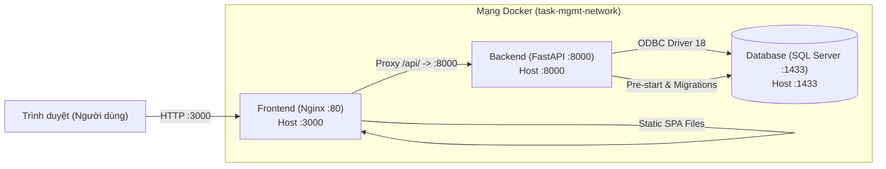

# Task Management System (Fieldnote)

Một ứng dụng quản lý công việc toàn diện và hiện đại được xây dựng theo kiến trúc full-stack, đáp ứng các tiêu chuẩn khắt khe về hiệu năng, bảo mật và trải nghiệm người dùng (UX Engineering).

---

## 1. Giới thiệu dự án

**Task Management System** cho phép người dùng cá nhân hoặc nhóm làm việc quản lý vòng đời công việc: từ khâu khởi tạo, phân loại mức độ ưu tiên, cập nhật trạng thái tiến độ đến theo dõi các hạn chót quan trọng thông qua một bảng điều khiển trực quan.

Hệ thống được thiết kế theo mô hình tách biệt Client - Server:
- **Backend API**: Xây dựng bằng FastAPI (Python 3.11), tương tác cơ sở dữ liệu qua SQLAlchemy 2.0 ORM và quản lý lược đồ bằng Alembic.
- **Frontend SPA**: Xây dựng bằng React 19, TypeScript strict mode, Vite 6 và Tailwind CSS v4, tối ưu hóa code-splitting với ngân sách tải trang khắt khe (< 150 KB gzip ban đầu).
- **Cơ sở dữ liệu**: Microsoft SQL Server 2022 (Developer Edition) kết nối thông qua Microsoft ODBC Driver 18 for SQL Server.
- **Đóng gói & Triển khai**: Docker & Docker Compose với quy trình multi-stage build cho Frontend (Nginx Alpine) và Backend (Python Slim).

---

## 2. Công nghệ sử dụng (Tech Stack)

### Backend
- **Framework**: [FastAPI](https://fastapi.tiangolo.com/) 0.115+ (Python 3.11)
- **ASGI Server**: [Uvicorn](https://www.uvicorn.org/)
- **Cơ sở dữ liệu**: Microsoft SQL Server 2022
- **ORM & Driver**: [SQLAlchemy](https://www.sqlalchemy.org/) 2.0+, [pyodbc](https://github.com/mkleehammer/pyodbc) 5.1+ (ODBC Driver 18)
- **Migration**: [Alembic](https://alembic.sqlalchemy.org/) 1.14+
- **Xác thực & Bảo mật**: Argon2id (`argon2-cffi`), JSON Web Token (`PyJWT` - thuật toán HS256)
- **Validation**: [Pydantic](https://docs.pydantic.dev/) v2 & `pydantic-settings`
- **Testing & Linter**: Pytest, Pytest-Cov, HTTPX, Ruff

### Frontend
- **Thư viện UI**: [React](https://react.dev/) 19.3+
- **Ngôn ngữ**: TypeScript 5.9+ (Strict Mode)
- **Build Tool**: [Vite](https://vite.dev/) 6.3+
- **Styling**: [Tailwind CSS](https://tailwindcss.com/) v4
- **Routing**: [React Router](https://reactrouter.com/) 8.5+
- **Icons**: [Lucide React](https://lucide.dev/)
- **Testing & Linter**: Vitest, React Testing Library, ESLint

### DevOps & Infrastructure
- **Containerization**: Docker, Docker Compose (v2)
- **Web Server / Reverse Proxy**: Nginx 1.27 Alpine
- **CI/CD**: GitHub Actions (Tự động hóa kiểm thử backend và frontend, linting, typecheck và production build)

---

## 3. Kiến trúc hệ thống



### Quy trình khởi động container (Startup Sequence):
1. **Container `db`** khởi chạy SQL Server 2022 và định kỳ thực thi healthcheck qua lệnh `sqlcmd`.
2. **Container `backend`** chờ container `db` chuyển sang trạng thái `healthy`:
   - Kích hoạt `python -m app.db.pre_start`: Kiểm tra xác thực tới SQL Server, tự động tạo cơ sở dữ liệu `task_management_db` nếu chưa tồn tại.
   - Kích hoạt `alembic upgrade head`: Thực thi toàn bộ migration schema.
   - Nếu biến môi trường `SEED_DATABASE=true`, kích hoạt `python -m app.db.seed` để nạp tài khoản và công việc mẫu.
   - Khởi động Uvicorn server tại `0.0.0.0:8000`.
3. **Container `frontend`** chờ `backend` chuyển sang trạng thái `healthy`:
   - Nginx phục vụ static file SPA (hỗ trợ HTML5 routing qua fallback `try_files $uri $uri/ /index.html`).
   - Reverse proxy toàn bộ request `/api/` tới `http://backend:8000`.

---

## 4. Tính năng đã hoàn thành

### Quản lý tài khoản (Authentication)
- [x] Đăng ký tài khoản người dùng mới với xác thực email hợp lệ và mật khẩu mạnh.
- [x] Đăng nhập bằng JWT Access Token, bảo vệ phiên làm việc qua LocalStorage an toàn.
- [x] Mã hóa mật khẩu một chiều bằng thuật toán **Argon2id**.
- [x] Chống tấn công timing attack (User Enumeration Mitigation) bằng hash giả lập khi kiểm tra email không tồn tại.
- [x] Khôi phục phiên làm việc tự động khi refresh trang (`/auth/me`).

### Không gian làm việc (Task Workspace)
- [x] **CRUD công việc đầy đủ**: Tạo mới, xem chi tiết, chỉnh sửa và xóa (kèm modal xác nhận an toàn).
- [x] **Trường dữ liệu**: Tiêu đề, mô tả, trạng thái (`TODO`, `IN_PROGRESS`, `DONE`), mức ưu tiên (`LOW`, `MEDIUM`, `HIGH`), hạn chót (UTC timezone-aware).
- [x] **Đổi nhanh trạng thái**: Cập nhật trạng thái trực tiếp ngay trên từng dòng danh sách với cơ chế optimistic rollback khi có lỗi mạng.
- [x] **Tìm kiếm & Bộ lọc**: Tìm kiếm theo từ khóa (có debounce), lọc theo trạng thái và mức độ ưu tiên.
- [x] **Phân trang dữ liệu**: Lựa chọn kích thước trang (10, 20, 50) và chuyển trang mượt mà.
- [x] **Deep-link liên kết**: Truy cập `/tasks?highlight=<id>` tự động cuộn đến task hoặc hiển thị banner thông báo nếu task nằm ngoài trang hiện tại.

### Bảng điều khiển (Dashboard)
- [x] Thống kê tổng số task, số task đã hoàn thành, đang thực hiện và cần làm.
- [x] Tính toán tỷ lệ hoàn thành (completion rate).
- [x] Danh sách công việc sắp đến hạn (sắp xếp tăng dần theo hạn chót).

### Bảng Kanban (Kanban Board)
- [x] **Trực quan hóa quy trình 3 cột**: Phân nhóm trạng thái rõ ràng gồm Cần làm (`TODO`), Đang thực hiện (`IN_PROGRESS`), và Hoàn thành (`DONE`).
- [x] **Kéo và thả trực quan (Native HTML5 Drag & Drop)**: Hỗ trợ kéo thả card giữa các cột trực quan, tương thích trình duyệt mà không cần thư viện ngoài.
- [x] **Hỗ trợ tiếp cận (Quick Move / Accessibility)**: Menu chuyển trạng thái nhanh ngay trên từng task card dành cho người dùng điều hướng bằng bàn phím hoặc trên thiết bị di động.
- [x] **Cập nhật lạc quan & Khôi phục (Optimistic Updates & Rollback)**: Cập nhật giao diện tức thời khi di chuyển trạng thái; tự động rollback vị trí cũ và hiển thị thông báo lỗi chi tiết nếu API trả về thất bại.
- [x] **Bảo vệ cập nhật đồng thời (Concurrent Task Updates Guard)**: Khóa thao tác trùng lặp trên cùng một công việc đang trong quá trình đồng bộ (`updatingTaskIds`).
- [x] **Giới hạn hiển thị 300 công việc**: Tải tối đa 300 công việc kèm banner cảnh báo rõ ràng khi vượt ngưỡng (khuyến nghị kết hợp tìm kiếm và bộ lọc độ ưu tiên).

### Tự động hóa CI/CD (GitHub Actions CI)
- [x] **Backend CI**: Kiểm thử tự động trên môi trường Python 3.11, kiểm tra format/linting với Ruff và toàn bộ 125 test cases với Pytest.
- [x] **Frontend CI**: Kiểm thử tự động trên môi trường Node 22, chạy Vitest (202 tests), TypeScript typecheck (`tsc --noEmit`), ESLint và Vite production build.
- [x] **Triggers linh hoạt**: Kích hoạt khi có `push` vào nhánh `main`, `master`, `feat/**`, `fix/**`; khi tạo `pull_request` vào `main`, `master`, `feat/**`; hoặc kích hoạt thủ công qua `workflow_dispatch`.
- [x] **Kiểm soát đồng thời (Concurrency Control)**: Tự động hủy job cũ đang chạy dở dang khi ref nhận commit mới (`cancel-in-progress: true`).
- [x] **Phân quyền tối thiểu (Least Privilege Permissions)**: Thiết lập cấu hình bảo mật `permissions: contents: read` ở phạm vi toàn workflow.

### Hiệu năng & Tối ưu hóa (Performance)
- [x] **Route-level Code Splitting**: Áp dụng `React.lazy` và `Suspense` cho các trang, giữ nguyên App Header và Sidebar không bị unmount khi chuyển trang.
- [x] **Modal-level Code Splitting**: Các hộp thoại CRUD chỉ tải mã nguồn khi người dùng mở thao tác.
- [x] **Tiết kiệm request**: Loại bỏ hoàn toàn duplicate GET request khi mở chi tiết công việc nếu dữ liệu đã có sẵn trong danh sách (`initialTask` remediation).
- [x] **Ngân sách Bundle**: Toàn bộ các route đều đạt tiêu chuẩn < 150 KB gzip tải ban đầu.

---

## 5. Trạng thái tính năng (Completed / Not Implemented)

Bảng tổng hợp chi tiết mức độ hoàn thiện các hạng mục chức năng và phi chức năng trong dự án:

### Đã hoàn thành (Completed)
- [x] **Xác thực & Cô lập người dùng (Authentication & User Isolation)**: Đăng ký, đăng nhập JWT, băm mật khẩu Argon2id, chống timing attack, Các truy vấn dữ liệu được giới hạn theo người dùng hiện tại, với các kiểm thử xác nhận người dùng không thể truy cập dữ liệu của tài khoản khác.
- [x] **Quản lý công việc (Task CRUD)**: Tạo mới, xem chi tiết, cập nhật toàn diện và xóa an toàn.
- [x] **Tìm kiếm, Lọc & Phân trang (Search, Filters & Pagination)**: Debounce search, lọc trạng thái, lọc mức độ ưu tiên, phân trang linh hoạt.
- [x] **Bảng điều khiển (Dashboard & Upcoming Deadlines)**: Đếm tổng hợp chỉ số, tỷ lệ hoàn thành, danh sách 5 hạn chót sắp đến.
- [x] **Di chuyển CSDL & Nạp dữ liệu mẫu (Alembic Migrations & Database Seeder)**: Migration lược đồ tự động và seed dữ liệu mẫu phong phú.
- [x] **Tài liệu API (Swagger/OpenAPI & ReDoc)**: Tài liệu trực quan tương tác chuẩn OpenAPI tại `/docs` và `/redoc`.
- [x] **Đóng gói container (Docker Compose)**: Khởi chạy toàn bộ hệ thống gồm SQL Server 2022, FastAPI backend và Nginx frontend bằng 1 lệnh duy nhất.
- [x] **Bảng Kanban (Kanban Board)**: 3 cột trạng thái, Native HTML5 Drag and Drop, Quick Move tiếp cận, optimistic updates và cảnh báo 300 tasks.
- [x] **Kiểm thử tự động (Automated Tests)**: 125 test cases backend (Pytest) và 202 test cases frontend (Vitest qua 20 test files) đều passed.
- [x] **Tích hợp liên tục (GitHub Actions CI)**: Workflow tự động kiểm tra linting, typecheck, testing và build độc lập cho cả backend và frontend.

### Chưa triển khai / Không cung cấp trong mã nguồn (Not Implemented / Not Provided)
- [ ] **Triển khai Cloud-hosted (Cloud Deployment)**: Hệ thống hiện tập trung vào môi trường Docker Compose cục bộ hoàn chỉnh; chưa thiết lập hạ tầng đám mây công cộng (AWS/GCP/Azure).
- *(Lưu ý: Video demo và upstream Pull Request là các hạng mục bàn giao nộp bài [submission deliverables], không phải là tính năng của ứng dụng).*

---

## 6. Yêu cầu cài đặt (Prerequisites)

Để khởi chạy dự án, máy tính cần đáp ứng:
- **Docker & Docker Compose v2**: Khuyến nghị Docker Desktop mới nhất.
- *(Nếu phát triển cục bộ không qua Docker)*:
  - **Python**: 3.11+
  - **Node.js**: 22+ & npm 11+
  - **Microsoft ODBC Driver 18 for SQL Server**: Đã cài đặt trên hệ điều hành host.

---

## 7. Biến môi trường (Environment Variables)

Sao chép file mẫu `.env.example` thành `.env`:
```bash
cp .env.example .env
```

| Tên biến | Mô tả | Mặc định gợi ý |
| :--- | :--- | :--- |
| `APP_ENV` | Môi trường ứng dụng (`development`, `test`, `production`) | `development` |
| `MSSQL_SA_PASSWORD` | Mật khẩu tài khoản `sa` của SQL Server (tối thiểu 8 ký tự, có hoa, thường, số, ký tự đặc biệt) | `YourStrong@Password123!` |
| `MSSQL_DB_NAME` | Tên cơ sở dữ liệu | `task_management_db` |
| `MSSQL_PORT` | Cổng ánh xạ SQL Server ra máy host | `1433` |
| `DATABASE_URL` | Chuỗi kết nối SQLAlchemy pyodbc | Xem hướng dẫn trong `.env.example` |
| `SEED_DATABASE` | Cho phép tự động nạp dữ liệu mẫu khi khởi động | `true` |
| `JWT_SECRET` | Khóa bí mật dùng để ký token (tối thiểu 32 ký tự trong production) | Khóa ngẫu nhiên mạnh |
| `JWT_ALGORITHM` | Thuật toán ký JWT | `HS256` |
| `ACCESS_TOKEN_EXPIRE_MINUTES` | Thời hạn hiệu lực của access token (phút) | `60` |
| `CORS_ORIGINS` | Danh sách các origin web được phép truy cập API | `http://localhost:3000,http://localhost:5173` |
| `BACKEND_PORT` | Cổng host cho Backend container | `8000` |
| `FRONTEND_PORT` | Cổng host cho Frontend container | `3000` |

> [!CAUTION]
> Tuyệt đối không commit file `.env` chứa thông tin nhạy cảm vào kho mã nguồn Git.

---

## 8. Hướng dẫn khởi chạy với Docker Compose (Khuyến nghị)

Chỉ với một câu lệnh duy nhất, toàn bộ hệ thống gồm Database, Backend và Frontend sẽ được xây dựng và khởi chạy tự động:

### Khởi động hệ thống
```bash
docker compose up --build -d
```

### Kiểm tra trạng thái và logs
```bash
# Xem trạng thái các container
docker compose ps

# Theo dõi logs tổng hợp
docker compose logs -f

# Theo dõi logs riêng backend
docker compose logs -f backend
```

### Truy cập ứng dụng
- **Giao diện người dùng (Frontend)**: [http://localhost:3000](http://localhost:3000)
- **Tài liệu API Swagger UI**: [http://localhost:8000/docs](http://localhost:8000/docs)
- **Tài liệu API ReDoc**: [http://localhost:8000/redoc](http://localhost:8000/redoc)
- **API Health Check**: [http://localhost:8000/health](http://localhost:8000/health)

### Tài khoản trải nghiệm có sẵn (Demo Account)
Khi biến môi trường `SEED_DATABASE=true`, hệ thống tự động khởi tạo sẵn tài khoản trải nghiệm phục vụ việc kiểm thử:
- **Email**: `demo@example.com`
- **Mật khẩu**: `DemoPassword123!`
*(Tài khoản được cung cấp sẵn 9 công việc mẫu với đủ trạng thái, mức ưu tiên và hạn chót)*.

### Dừng hệ thống
```bash
# Dừng container an toàn (bảo toàn volume dữ liệu mssql_data)
docker compose down
```

> [!WARNING]
> Không sử dụng `docker compose down -v` để tránh làm mất cơ sở dữ liệu đang lưu trong volume `mssql_data`.

---

## 9. Hướng dẫn phát triển cục bộ (Local Development)

Nếu muốn chạy trực tiếp trên máy host không qua Docker:

### A. Khởi chạy Backend (FastAPI)
1. Di chuyển vào thư mục backend và tạo môi trường ảo:
   ```bash
   cd backend
   python -m venv .venv
   # Windows:
   .venv\Scripts\activate
   # Linux / macOS:
   source .venv/bin/activate
   ```
2. Cài đặt thư viện:
   ```bash
   pip install -r requirements.txt
   ```
3. Cấu hình biến môi trường trong file `.env` ở thư mục gốc trỏ tới SQL Server của máy host.
4. Chạy migration cơ sở dữ liệu:
   ```bash
   alembic upgrade head
   ```
5. Nạp dữ liệu mẫu (Tùy chọn):
   ```bash
   python -m app.db.seed
   ```
6. Khởi động server backend:
   ```bash
   uvicorn app.main:app --reload --port 8000
   ```

### B. Khởi chạy Frontend (React + Vite)
1. Di chuyển vào thư mục frontend:
   ```bash
   cd frontend
   ```
2. Cài đặt dependencies:
   ```bash
   npm ci
   ```
3. Khởi chạy dev server:
   ```bash
   npm run dev
   ```
4. Truy cập giao diện tại: [http://localhost:5173](http://localhost:5173) (Vite đã được cấu hình proxy tự động chuyển tiếp `/api` tới backend port 8000).

---

## 10. Kiểm thử và Kiểm định chất lượng (QA & Tests)

### Backend Tests & Lint
```bash
# Chạy toàn bộ 125 Pytest test cases
pytest backend/tests

# Kiểm tra code style và import sorting bằng Ruff
ruff check backend
```

### Frontend Tests, Typecheck & Build
```bash
# Kiểm tra TypeScript compilation
npm --prefix frontend run typecheck

# Kiểm tra ESLint
npm --prefix frontend run lint

# Chạy toàn bộ 202 test cases (20 test files) bằng Vitest
npm --prefix frontend test -- --run

# Kiểm tra bản build production
npm --prefix frontend run build
```

> [!NOTE]
> Dự án đạt 125/125 test cases backend (Pytest) và 202/202 test cases frontend (Vitest) vượt qua kiểm thử thành công. Toàn bộ kịch bản kiểm thử đã định nghĩa đều đạt yêu cầu, tuy nhiên việc passing toàn bộ tests không đồng nghĩa với 100% code coverage.

---

## 11. Hạn chế đã biết (Known Limitations)

Dưới đây là các quyết định thiết kế và giới hạn kiến trúc hiện tại của hệ thống:

1. **Thu hồi phiên đăng xuất với Stateless JWT (Stateless JWT Logout)**:
   Hệ thống sử dụng mô hình JWT không lưu trạng thái (stateless). Thao tác đăng xuất hiện tại dựa trên việc client xóa access token khỏi LocalStorage. Hệ thống chưa tích hợp Redis token blacklist hoặc cơ chế thu hồi token tức thời ở phía server; một token đã cấp vẫn có hiệu lực về mặt mã hóa cho đến khi hết hạn (`ACCESS_TOKEN_EXPIRE_MINUTES`) trừ khi bị từ chối bởi các tầng xác thực khác.
2. **Giới hạn số lượng công việc trên Kanban (Kanban 300 Tasks Cap)**:
   Để tối ưu hóa hiệu năng render DOM và trải nghiệm kéo thả trên trình duyệt, bảng Kanban được cấu hình tải tối đa 300 công việc (thông qua phân trang tối đa 3 trang song song). Khi tài khoản có trên 300 công việc, bảng sẽ hiển thị banner cảnh báo và khuyến nghị người dùng kết hợp bộ lọc từ khóa tìm kiếm hoặc lọc mức độ ưu tiên để thu hẹp tập dữ liệu hiển thị.
3. **Môi trường cơ sở dữ liệu kiểm thử so với Docker Runtime (SQLite vs. SQL Server)**:
   Bộ kiểm thử tự động backend (`pytest`) sử dụng SQLite in-memory nhằm đảm bảo tốc độ thực thi, không phụ thuộc service bên ngoài và tính độc lập giữa các test cases. Trong khi đó, Docker runtime sử dụng Microsoft SQL Server 2022 (ODBC Driver 18). Hai hệ quản trị này có những khác biệt về dialect và hành vi truy vấn. Các kiểm tra Docker healthcheck, Alembic migration và seeder giúp xác minh kết nối, khởi tạo schema và nạp dữ liệu trên SQL Server, nhưng không thay thế hoàn toàn việc chạy toàn bộ automated test suite trực tiếp trên SQL Server.
4. **Phạm vi triển khai đám mây (Cloud Deployment Scope)**:
   Mã nguồn hiện tại tập trung cung cấp giải pháp đóng gói hoàn chỉnh chạy trên Docker và Docker Compose cục bộ. Việc cấu hình hạ tầng đám mây công cộng (như AWS, GCP hay Azure) chưa nằm trong phạm vi của kho mã nguồn này.

---

## 12. Xử lý sự cố thường gặp (Troubleshooting)

### 1. Lỗi kết nối SQL Server (`Can't open lib 'ODBC Driver 18 for SQL Server'`)
- **Nguyên nhân**: Hệ điều hành chưa cài đặt Microsoft ODBC Driver 18.
- **Khắc phục**: Khi sử dụng Docker, driver đã được tích hợp sẵn trong container. Nếu chạy trên máy host, hãy tải và cài đặt driver từ trang chủ Microsoft.

### 2. Lỗi SSL/Certificate (`SSL Provider: [error:0A000086:SSL routines::certificate verify failed]`)
- **Nguyên nhân**: ODBC Driver 18 mặc định bật mã hóa và kiểm tra chứng chỉ máy chủ.
- **Khắc phục**: Đảm bảo chuỗi kết nối trong môi trường phát triển có tham số `TrustServerCertificate=yes`.

### 3. Lỗi xung đột cổng (`Port 1433/8000/3000 already in use`)
- **Nguyên nhân**: Đang có ứng dụng khác (hoặc instance SQL Server nội bộ) chiếm cổng.
- **Khắc phục**: Thay đổi biến `MSSQL_PORT`, `BACKEND_PORT`, hoặc `FRONTEND_PORT` trong file `.env` sang các cổng khác (ví dụ: `1434`, `8001`, `3001`).

### 4. Lỗi ký tự kết thúc dòng trên Linux container (`entrypoint.sh: no such file or directory`)
- **Nguyên nhân**: File script được lưu với định dạng CRLF của Windows thay vì LF của Unix.
- **Khắc phục**: Trong `backend/Dockerfile` đã được bổ sung lệnh `sed -i 's/\r$//' /app/entrypoint.sh` để tự động chuẩn hóa định dạng dòng trước khi thực thi.

---

## 13. Giấy phép (License)
Dự án được phát triển phục vụ mục đích đánh giá tuyển dụng và đào tạo kỹ thuật nội bộ.
