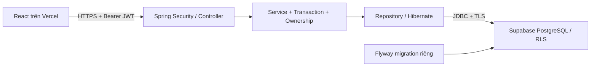

# TaskFlow — Task Management System

**Bài thực tập TechVanguard · Trần Huỳnh Minh Kiệt**

TaskFlow là ứng dụng quản lý dự án và công việc cá nhân, gồm giao diện React tiếng Việt và REST API Spring Boot. Người dùng theo dõi tiến độ qua dashboard, danh sách công việc và bảng Kanban. Backend kiểm tra quyền sở hữu dữ liệu, xác thực JWT gắn với phiên đăng nhập và áp dụng ràng buộc toàn vẹn trong PostgreSQL.

Đề bài gốc: [docs/assignment.md](docs/assignment.md).

## Demo và địa chỉ triển khai

| Thành phần | Địa chỉ |
| --- | --- |
| Frontend — Vercel | https://frontend-eight-tawny-fm551jojda.vercel.app |
| Backend — Render | https://task-management-system-i7xu.onrender.com |
| Swagger UI | https://task-management-system-i7xu.onrender.com/swagger-ui/index.html |
| OpenAPI JSON | https://task-management-system-i7xu.onrender.com/v3/api-docs |
| Health | https://task-management-system-i7xu.onrender.com/api/health |
| Video demo | [Xem video TaskFlow trên Google Drive](https://drive.google.com/drive/folders/1fDbQooBYB8MPk0sbc2MKrPE0jAIyAhzg?usp=drive_link) |

Tác giả xác nhận thư mục Drive chứa video demo; công cụ chưa xác minh nội dung, thời lượng hoặc quyền xem. Trước khi nộp, kiểm tra link bằng cửa sổ ẩn danh và bảo đảm người đánh giá xem được video.

Các URL trên là địa chỉ triển khai được cung cấp, không bảo đảm production đang chạy mã nguồn mới nhất. Trong FE-08, sáu đường dẫn frontend trả HTML SPA với HTTP 200 và dùng đúng API origin; bundle phục vụ khác bản local đã kiểm thử. Backend từng trả health/OpenAPI 200 và API bảo vệ 401, nhưng lần kiểm tra tiếp theo bị timeout, browser fetch từ Vercel thất bại. **CORS và luồng CRUD có xác thực trên production chưa được xác minh hoàn chỉnh.** Không có thao tác deploy hay ghi dữ liệu production trong lần chuẩn bị tài liệu này.

## Chức năng đã triển khai

- **Tài khoản:** đăng ký với email chuẩn hóa, đăng nhập, đăng xuất phiên hiện tại, xem thông tin cá nhân. BCrypt bảo vệ mật khẩu; JWT HS256 được kiểm tra chữ ký, issuer/audience, thời hạn và phiên. Database chỉ lưu hash token phiên.
- **Dự án:** tạo, xem, sửa, xóa, lưu trữ; tên, mô tả, màu, trạng thái, ngày bắt đầu và hạn hoàn thành. Xóa dự án xóa task liên quan bằng FK cascade.
- **Công việc:** CRUD, trạng thái `TODO / IN_PROGRESS / DONE`, ưu tiên `LOW / MEDIUM / HIGH`, hạn hoàn thành; tìm tiêu đề không phân biệt hoa thường, lọc, phân trang và sắp xếp. Backend hỗ trợ chuyển task giữa dự án cùng chủ sở hữu.
- **Tất cả dự án:** frontend tổng hợp các trang task từ những dự án thuộc người dùng để lọc/sắp xếp/phân trang toàn bộ kết quả.
- **Kanban:** kéo thả, điều khiển bàn phím, cập nhật trạng thái lạc quan và hoàn tác khi lỗi; drawer xem/sửa/xóa task.
- **Dashboard:** tổng task, số lượng theo trạng thái, tỷ lệ hoàn thành, sắp đến hạn trong 7 ngày và quá hạn; loại DONE khỏi hai danh sách hạn; lọc theo dự án.
- **Phân quyền:** owner lấy từ principal, truy vấn có điều kiện ownership và RLS cưỡng chế theo transaction. Tài nguyên khác chủ trả 404; thiếu xác thực trả 401. API không cho sửa/xóa task trong dự án archived.
- **Giao diện:** responsive, route bảo vệ, trang 404, toast toàn cục, cache theo phiên, tải lại nền; reload cùng tab khôi phục đăng nhập sau kiểm tra `/api/auth/me`.
- **Nền tảng:** DTO, response lỗi thống nhất, validation, Swagger/OpenAPI, Flyway, seed local thủ công, unit/integration tests, Dockerfile backend Java 21.

## Công nghệ

| Lớp | Công nghệ trong repository |
| --- | --- |
| Frontend | React 19, JavaScript, Vite 8, Tailwind CSS 4, React Router 7 |
| API và trạng thái | Axios, TanStack Query 5, Sonner, dnd-kit |
| Backend | Java 21, Spring Boot 3.5.16, Maven Wrapper, Spring Web/Data JPA/Security/Validation, Lombok |
| Xác thực | BCrypt, JWT HS256 qua Spring Security JOSE |
| Database | PostgreSQL/Supabase, Hibernate, Flyway core và PostgreSQL module |
| API docs và test | springdoc-openapi 2.10.1, JUnit 5, Mockito, Testcontainers PostgreSQL; Node test runner, Playwright |
| Triển khai | Dockerfile đa giai đoạn backend, Render, Vercel |

Phiên bản chi tiết: [pom.xml](backend/pom.xml), [package.json](frontend/package.json) và lockfile frontend.

## Kiến trúc



Controller nhận DTO, service xử lý nghiệp vụ/transaction, repository truy vấn, mapper chuyển entity sang DTO. Không trả password hash hay token hash ra API. Mỗi transaction đặt `app.current_user_id` từ principal đã xác thực, tránh rò identity giữa kết nối trong pool.

Bốn bảng nghiệp vụ: `users` sở hữu `sessions` và `projects`; `projects` sở hữu `tasks`. Khóa chính UUID; PostgreSQL enum ánh xạ Java bằng named enum; ngày dùng `LocalDate`, thời điểm dùng `Instant`. Trigger quản lý `updated_at` và `completed_at`: vào DONE đặt thời điểm hoàn thành, mở lại thì xóa. Flyway có thêm bảng quản lý `flyway_schema_history`.

## Cấu trúc repository

```text
Task-Management-System/
├── README.md
├── docs/assignment.md             # Đề bài gốc
├── images/                       # Hình minh họa
├── backend/
│   ├── pom.xml, mvnw, mvnw.cmd
│   ├── Dockerfile, .dockerignore, .env.example
│   ├── src/main/java/backend/
│   │   ├── config/ controller/ service/ repository/
│   │   ├── entity/ dto/ mapper/ enums/
│   │   └── security/ exception/
│   ├── src/main/resources/db/migration/  # V1, V2
│   ├── src/test/                 # Unit và PostgreSQL integration test
│   ├── scripts/                  # seed-dev.sql, Test-Postgres.ps1
│   └── docs/                     # API, database, deployment
├── frontend/
│   ├── package.json, package-lock.json, vite.config.js
│   ├── vercel.json, .env.example
│   ├── src/                      # api, components, contexts, hooks,
│   │                             # layouts, pages, routes, query, assets
│   ├── tests/                    # Node unit/cache tests
│   ├── scripts/                  # Browser checks
│   └── docs/
└── scripts/                      # Full-stack test, quét secret
```

## Điều kiện chạy

- JDK **21**, `JAVA_HOME` trỏ đúng JDK; Maven Wrapper đã có sẵn.
- Node.js theo `engines`: **^20.19.0 hoặc >=22.12.0**, npm. FE-08 dùng Node 22.17.0.
- PostgreSQL local hoặc database phát triển riêng; `psql` cho provisioning/seed. Không chạy seed/test với production.
- Docker chỉ cần khi build image hoặc chạy Testcontainers. Windows có thể dùng PostgreSQL local cho integration test.
- Lệnh bên dưới dùng **Windows PowerShell**, bắt đầu từ thư mục gốc nếu không ghi khác. Linux/macOS dùng `./mvnw` thay `.\mvnw.cmd`.

## Biến môi trường

Tạo cấu hình riêng nếu chưa có, không ghi đè file của bạn:

```powershell
if (!(Test-Path backend/.env)) { Copy-Item backend/.env.example backend/.env }
if (!(Test-Path frontend/.env.local)) { Copy-Item frontend/.env.example frontend/.env.local }
```

Spring Boot **không tự đọc `.env`**: khai báo trong Run Configuration của IDE hoặc `$env:TEN_BIEN` ở shell chạy backend. Vite tự đọc `frontend/.env.local`. Docker chỉ đọc file khi có `--env-file`. File riêng được Git ignore; không commit chúng.

| Biến backend | Ý nghĩa/mặc định |
| --- | --- |
| `PORT` | Cổng HTTP, mặc định `8080`, bind `0.0.0.0`; dùng giá trị Render cấp khi deploy. |
| `DB_URL` | Bắt buộc; JDBC PostgreSQL URL không chứa username/password. |
| `DB_USERNAME`, `DB_PASSWORD` | Bắt buộc; role runtime. |
| `DB_POOL_SIZE` | Hikari tối đa `5`, minimum idle `1`; cân đối giới hạn DB. |
| `FRONTEND_URL` | Một CORS origin chính xác. Code mặc định `http://localhost:3000`; dùng `http://localhost:5173` cho Vite local. |
| `JWT_SECRET` | Bắt buộc; Base64 của ít nhất 32 byte ngẫu nhiên. Không dùng lại key test. |
| `JWT_EXPIRATION` | Mili giây; mặc định `900000`, cho phép `60000–3600000`. |
| `FLYWAY_ENABLED` | Mặc định `true` khi app startup local; production web dùng `false` sau migration riêng. |
| `FLYWAY_DB_URL`, `FLYWAY_DB_USERNAME`, `FLYWAY_DB_PASSWORD` | Role migration. Startup local fallback sang `DB_*`; migration-only bắt buộc cả ba. |
| `DASHBOARD_TIME_ZONE` | Múi giờ tính ngày, mặc định `UTC`; có thể chọn `Asia/Ho_Chi_Minh`. |
| `API_DOCS_ENABLED` | Mặc định `true`; bật OpenAPI và Swagger UI. |
| `JAVA_TOOL_OPTIONS` | Tùy chọn JVM; Dockerfile mặc định `-XX:MaxRAMPercentage=65.0`. Không đặt secret trong tham số JVM. |

| Biến frontend | Giá trị |
| --- | --- |
| `VITE_API_BASE_URL` | Local: `http://localhost:8080`; demo: `https://task-management-system-i7xu.onrender.com`. Chỉ origin, không thêm `/api`, credentials, query hoặc fragment. |

Mọi `VITE_*` đều có thể đọc trong trình duyệt. Không đưa DB password, JWT signing key hoặc access token vào biến build. Đổi biến Vite cần restart dev server/build lại.

## PostgreSQL và backend local

### 1. Tạo database phát triển

Kết nối **instance PostgreSQL local** bằng quản trị viên:

```powershell
psql -h 127.0.0.1 -p 5432 -U postgres -d postgres -W
```

Trong `psql`, cho database local mới dành riêng cho bài thực tập:

```sql
CREATE ROLE tms_migrator LOGIN NOSUPERUSER NOCREATEDB NOCREATEROLE NOBYPASSRLS;
CREATE ROLE tms_runtime LOGIN NOSUPERUSER NOCREATEDB NOCREATEROLE NOBYPASSRLS;
\password tms_migrator
\password tms_runtime
CREATE DATABASE task2_dev OWNER tms_migrator;
\connect task2_dev
REVOKE CREATE ON SCHEMA public FROM PUBLIC;
GRANT USAGE, CREATE ON SCHEMA public TO tms_migrator;
```

`\password` hỏi password kín; không đặt password literal trong SQL/history. Thoát `psql` bằng `\q`. Nếu role/database đã tồn tại, kiểm tra thay vì tạo lại. Đây không phải SQL chạy trên Supabase production.

### 2. Build và migration

Trong PowerShell từ thư mục gốc:

```powershell
Set-Location backend
.\mvnw.cmd -DskipTests package
if ($LASTEXITCODE -ne 0) { throw 'Build backend thất bại' }
$env:FLYWAY_DB_URL = 'jdbc:postgresql://127.0.0.1:5432/task2_dev'
$env:FLYWAY_DB_USERNAME = 'tms_migrator'
$migrationPassword = Read-Host 'Password migration local' -AsSecureString
$env:FLYWAY_DB_PASSWORD = [System.Net.NetworkCredential]::new('', $migrationPassword).Password
try {
    java '-Dloader.main=backend.config.DatabaseMigration' -cp target/backend-0.0.1-SNAPSHOT.jar org.springframework.boot.loader.launch.PropertiesLauncher
    if ($LASTEXITCODE -ne 0) { throw 'Flyway thất bại; không khởi động ứng dụng' }
} finally {
    Remove-Item Env:FLYWAY_DB_PASSWORD -ErrorAction SilentlyContinue
    Remove-Variable migrationPassword -ErrorAction SilentlyContinue
}
```

`-DskipTests` ở bước đóng gói không phải kết quả test. Entry point migration-only không chạy HTTP/JWT/seed, cấm clean và automatic baseline.

### 3. Cấp quyền runtime sau migration

Kết nối **local `task2_dev`** bằng quản trị viên và chạy:

```sql
GRANT USAGE ON SCHEMA public TO tms_runtime;
GRANT SELECT, INSERT, UPDATE, DELETE
    ON public.users, public.sessions, public.projects, public.tasks TO tms_runtime;
GRANT USAGE ON TYPE public."ProjectStatus", public."TaskStatus", public."TaskPriority" TO tms_runtime;
GRANT EXECUTE ON FUNCTION public.current_app_user_id() TO tms_runtime;
```

Không cấp owner, BYPASSRLS, schema CREATE, TRUNCATE, membership trong role migration hay quyền ghi Flyway history cho runtime. `ENABLE ROW LEVEL SECURITY` đơn lẻ không tạo isolation: dự án dùng policy + FORCE RLS + principal đã kiểm chứng. Superuser/BYPASSRLS vẫn bỏ qua RLS. Không truy vấn bảng ứng dụng trực tiếp từ Supabase frontend SDK.

### 4. Chạy backend

Trong `backend/`, cùng cửa sổ PowerShell:

```powershell
$env:DB_URL = 'jdbc:postgresql://127.0.0.1:5432/task2_dev'
$env:DB_USERNAME = 'tms_runtime'
$runtimePassword = Read-Host 'Password runtime local' -AsSecureString
$env:DB_PASSWORD = [System.Net.NetworkCredential]::new('', $runtimePassword).Password
Remove-Variable runtimePassword
$env:FLYWAY_ENABLED = 'false'
$env:PORT = '8080'
$env:FRONTEND_URL = 'http://localhost:5173'
$env:JWT_EXPIRATION = '900000'
$env:DASHBOARD_TIME_ZONE = 'Asia/Ho_Chi_Minh'
$keyBytes = New-Object byte[] 32
$rng = [System.Security.Cryptography.RandomNumberGenerator]::Create()
try { $rng.GetBytes($keyBytes) } finally { $rng.Dispose() }
$env:JWT_SECRET = [Convert]::ToBase64String($keyBytes)
Remove-Variable keyBytes
.\mvnw.cmd spring-boot:run
```

Key tạo trong bộ nhớ, không in ra console. Đổi key làm JWT cũ mất hiệu lực; muốn giữ qua lần restart backend thì lưu key riêng trong cấu hình IDE/secret local. Dừng bằng `Ctrl+C`; đóng shell hoặc xóa `Env:DB_PASSWORD`, `Env:JWT_SECRET` khi xong.

Mở `http://localhost:8080/api/health`, kỳ vọng `{"status":"UP"}`. Đây là liveness, không kiểm tra DB liên tục. Thiếu biến DB/JWT, key sai, DB không truy cập được hoặc schema không khớp sẽ làm startup thất bại; không có DB dự phòng. Hibernate luôn `ddl-auto=validate`, SQL auto-initialization tắt.

### Supabase PostgreSQL

Lấy thông tin từ **Connect → Session pooler**, port **5432**, username role/project reference đúng như Supabase hiển thị. Không dùng transaction pooler 6543 cho quy trình hiện tại.

```text
DB_URL=jdbc:postgresql://YOUR_SESSION_POOLER_HOST:5432/postgres?sslmode=require
DB_USERNAME=YOUR_RUNTIME_ROLE.YOUR_PROJECT_REF
DB_PASSWORD=YOUR_RUNTIME_ROLE_PASSWORD
```

Đây là password database role, không phải anon/service-role API key. `sslmode=require` mã hóa; `verify-full` kèm CA phù hợp xác thực hostname/chứng chỉ. Role migration sở hữu object và có DDL cần thiết; runtime là nonowner, không BYPASSRLS, chỉ nhận quyền cần dùng. Quyền thực tế phải được xét theo ACL Supabase, không áp dụng provisioning local trực tiếp lên production. Xem [database-design.md](backend/docs/database-design.md), [deployment.md](backend/docs/deployment.md).

## Frontend local

Mở terminal thứ hai từ thư mục gốc:

```powershell
Set-Location frontend
# Trong .env.local: VITE_API_BASE_URL=http://localhost:8080
npm ci
npm run dev
```

Mở `http://localhost:5173`; giữ backend `FRONTEND_URL` đúng origin. Nếu Vite chọn cổng khác vì 5173 bận, giải phóng cổng hoặc chỉnh CORS. Route chính: `/login`, `/register`, `/dashboard`, `/projects`, `/tasks`, `/kanban`; có task theo dự án và trang chi tiết.

Không có tài khoản demo mặc định. Đăng ký user phát triển bằng giao diện; password ít nhất 12 ký tự, tối đa 72 byte UTF-8, không NUL theo validator backend.

## Flyway và kiểm tra schema

Chỉ chạy migration ở `backend/src/main/resources/db/migration/`:

| Migration | Nội dung |
| --- | --- |
| `V1__create_task_management_schema.sql` | Bốn bảng, UUID, enum, FK/index/check constraints, trigger timestamp/completion, policy và FORCE RLS |
| `V2__allow_transaction_scoped_login_lookup.sql` | Policy SELECT email chính xác theo transaction để backend kiểm tra password khi login |

`backend/docs/database-schema.sql` là schema tham chiếu ban đầu, **không chạy thêm** sau Flyway. Không sửa migration đã áp dụng hoặc bật baseline-on-migrate để bỏ qua schema có sẵn. Schema không rỗng chưa có history cần kế hoạch adoption riêng.

Sau migration, quản trị viên kiểm tra metadata:

```sql
SELECT version, description, success
FROM public.flyway_schema_history ORDER BY installed_rank;
SELECT tablename, rowsecurity FROM pg_catalog.pg_tables
WHERE schemaname = 'public'
  AND tablename IN ('users', 'sessions', 'projects', 'tasks');
```

Kỳ vọng V1/V2 thành công, bốn bảng bật RLS. Metadata chưa chứng minh toàn bộ runtime grants đúng; integration test kiểm tra thêm ownership/RLS. Local PostgreSQL 18.7 có cảnh báo Flyway tested range kết thúc ở 17 dù migration/test thành công. Không xem đó là xác nhận Supabase production; kiểm tra phiên bản đích trước khi migration được cho phép.

## Seed dữ liệu phát triển

[backend/scripts/seed-dev.sql](backend/scripts/seed-dev.sql) đã có sẵn, nằm ngoài Flyway, không chạy lúc startup. Script chỉ chấp nhận DB tên **`task2_dev`** với địa chỉ server **`127.0.0.1`**; tạo **1 dự án + 2 task** (TODO và DONE), không tạo account/password/session. UUID cố định và `ON CONFLICT DO NOTHING` giúp chạy lại không nhân đôi, không ghi đè dữ liệu đã sửa.

1. Hoàn tất migration/grants, đăng ký **một user local** qua ứng dụng.
2. Lấy `user.id` từ JSON đăng ký hoặc `GET /api/auth/me` trong Swagger sau Authorize. Không đưa access token vào tài liệu.
3. Từ thư mục gốc, nhập UUID user local và chạy:

```powershell
$ownerId = Read-Host 'UUID user phát triển local'
psql -h 127.0.0.1 -p 5432 -U tms_runtime -d task2_dev -W -v "owner_id=$ownerId" -f backend/scripts/seed-dev.sql
if ($LASTEXITCODE -ne 0) { throw 'Seed thất bại; kiểm tra database/user/quyền' }
```

`-W` hỏi password kín. Script đặt identity trong transaction để tương thích RLS; UUID user phải tồn tại. Reload dự án/task để thấy dữ liệu. Seed dành cho **một owner** trong DB phát triển; không đổi owner rồi dùng lại cùng UUID seed. Muốn dọn, xóa dự án mẫu qua ứng dụng khi còn ACTIVE; task cascade. Không seed Supabase production hay tạo sample account tự động.

## Swagger và API

Local: `http://localhost:8080/swagger-ui.html`, `http://localhost:8080/v3/api-docs` khi `API_DOCS_ENABLED=true`. Register/login rồi nhập access token vào **Authorize** (Bearer scheme).

| Nhóm | Endpoint |
| --- | --- |
| Auth | `POST /api/auth/register`, `POST /api/auth/login`, `POST /api/auth/logout`, `GET /api/auth/me` |
| Project | `POST/GET /api/projects`, `GET/PUT/DELETE /api/projects/{id}`, `PATCH /api/projects/{id}/archive` |
| Task | `POST/GET /api/projects/{projectId}/tasks`, `GET/PUT/DELETE /api/tasks/{taskId}`, `PATCH /api/tasks/{taskId}/status` |
| Dashboard | `GET /api/dashboard/summary`, `/api/dashboard/upcoming`, `/api/dashboard/overdue` |
| Health | `GET /api/health` — công khai |

Register/login và health công khai; logout/me và nghiệp vụ cần JWT còn phiên hiệu lực. Không có `GET /api/tasks` toàn cục hay refresh endpoint. Task list nhận `search`, `status`, `priority`, `page`, `size`, `sort`; page từ 0, size mặc định 10/tối đa 100. Project list mặc định 20/tối đa 100. Hạn task là ngày lịch, không gồm giờ.

HTTP chính: 200 thành công, 201 tạo mới, 204 xóa/logout, 400 validation/tham số sai, 401 chưa xác thực, 403 bị cấm, 404 không tồn tại/khác chủ, 409 xung đột nghiệp vụ. Lỗi dùng `ApiErrorResponse`, phân trang dùng `PageResponse`.

Request/response, ví dụ và mã lỗi: [auth](backend/docs/authentication.md), [project](backend/docs/projects.md), [task](backend/docs/tasks.md), [dashboard](backend/docs/dashboard.md), [OpenAPI/testing](backend/docs/api-documentation-and-tests.md).

## Kiểm thử và build

### Frontend

Từ `frontend/`:

```powershell
npm ci
npm test
npm run lint
npm run build
npm run preview -- --host 127.0.0.1 --port 4173 --strictPort
```

Output `frontend/dist`. Browser smoke cần dependency tùy chọn và Microsoft Edge:

```powershell
npm install --no-save --package-lock=false playwright
# Giữ preview chạy ở terminal khác; lệnh dưới chạy từ frontend/
node scripts/performance-smoke.mjs
node scripts/all-projects-smoke.mjs
```

Hai script intercept backend, không chứng minh API production. Playwright không phải dependency thường trực. `npm ci` có thể xóa package tùy chọn; cài lại trước browser test nếu cần.

### Backend

Từ `backend/`, JDK 21:

```powershell
.\mvnw.cmd clean verify
```

Compile/test/package JAR `target/backend-0.0.1-SNAPSHOT.jar`. PostgreSQL integration tests ưu tiên Testcontainers khi Docker hoạt động. Nếu không có Docker hay override DB local cách ly, test DB **skip**; exit 0 không đồng nghĩa toàn bộ integration test đã chạy.

Windows có PostgreSQL binaries, từ `backend/`:

```powershell
.\scripts\Test-Postgres.ps1 -PostgresBin 'C:/Program Files/PostgreSQL/18/bin'
```

Script tạo cluster loopback riêng trong `backend/target/`, role migration/runtime riêng, chạy test rồi dừng server trong `finally`; đổi đường dẫn binaries theo máy. Không đọc `.env` production. Biến test `TASK2_TEST_DB_URL` chỉ chấp nhận DB disposable `task2_test` trên loopback với port cụ thể. Fixture có truncate, không tunnel test về production.

### Full-stack với database thật cách ly

Sau khi cài dependency frontend và Playwright, từ thư mục gốc:

```powershell
.\scripts\Test-FrontendIntegration.ps1 -JavaHome 'C:/Program Files/Java/jdk-21' -PostgresBin 'C:/Program Files/PostgreSQL/18/bin'
node scripts/check-secrets.mjs
```

Harness tạo PostgreSQL riêng, áp dụng V1/V2 bằng migration-only, chạy Spring với nonowner runtime và preview riêng. Kiểm tra auth/reload, CRUD, All Projects, Kanban kéo thả, dashboard, ownership, archive/cascade, logout, JWT sai/hết hạn, responsive 375/768/1440px. Chỉ ghi loopback; logs ở `backend/target/fe08-e2e-*`; không nạp credential production. Script dừng process và phục hồi biến môi trường khi xong.

Quét secret chỉ phát hiện các pattern được định nghĩa ở indexed/working tracked files và file mới không ignore; không bảo đảm tuyệt đối hoặc quét toàn bộ nội dung lịch sử Git.

### Kết quả đã thực thi

| Phạm vi | Kết quả thực tế |
| --- | --- |
| Lần hoàn thiện tài liệu này | Frontend: **134 passed, 0 failed/skipped**; lint và production build thành công |
| Rà soát tài liệu lần này | Link file local và entry point lệnh đều tồn tại; mọi biến môi trường trong application.properties có trong env example và README; quét secret 236 tracked paths, không phát hiện pattern được chọn; git diff --check đạt |
| Backend ở FE-08 trước đó | 72 passed, 0 failures/errors/skips trên PostgreSQL 18.7 cách ly, Java 21 |
| Browser full-stack ở FE-08 trước đó | 4 nhóm PASS trên API/DB thật local, gồm drag, drawer delete, ownership, session, responsive |
| Browser mock ở FE-08 trước đó | 6 nhóm performance và 4 nhóm All Projects PASS |
| Docker image/Testcontainers | Chưa xác minh nhánh này do Docker daemon không khả dụng ở FE-08 |
| Production authenticated CRUD/CORS | Chưa xác minh hoàn chỉnh; không ghi dữ liệu production |

Kết quả FE-08 là lịch sử thực thi, không phải chạy lại backend/browser trong lần sửa tài liệu. Seed được đọc và đối chiếu schema, không chạy lại trong lần này. Các lệnh provisioning/migration/deploy được đối chiếu cấu trúc và entry point, không thực thi lên database của người dùng. Log mới: ignored `frontend/node_modules/.cache/submission-tests.log`; log cũ: `backend/target/fe08-postgres.log`, `backend/target/fe08-e2e-*`. Tài liệu chuyên đề có kết quả từng giai đoạn; số lượng test cũ không đại diện toàn bộ suite hiện tại.

## Docker và Docker Compose

Repo **có Dockerfile backend**, chưa có Docker Compose, Dockerfile frontend hay stack chạy một lệnh. Không có lệnh `docker compose up` áp dụng cho repo hiện tại.

Từ thư mục gốc, với `backend/.env` riêng cho **database phát triển**:

```powershell
docker build -t task-management-backend ./backend
docker run --rm --env-file backend/.env -e PORT=8080 -p 8080:8080 task-management-backend
```

Image đa giai đoạn Java 21, runtime nonroot. Build chỉ copy main sources, bỏ test và không kết nối DB; cần test riêng. `--env-file` nạp biến rõ ràng. Nếu DB ở Windows host, dùng `host.docker.internal` thay loopback trong JDBC URL và cấu hình PostgreSQL cho phép kết nối phù hợp. Seed hiện chỉ chấp nhận server loopback, không chạy qua hostname Docker này.

Sau migration riêng đặt `FLYWAY_ENABLED=false`. Nếu dùng startup migration cần cấp credential migration riêng, không biến runtime thành owner để vượt lỗi. Docker build/run chưa được xác minh ở môi trường thiếu daemon.

## Cấu hình triển khai

| Nền tảng | Cấu hình repository |
| --- | --- |
| Render backend | Root `backend`, Dockerfile `./Dockerfile`, health `/api/health`, cổng `PORT` |
| Supabase | JDBC SSL qua Session Pooler 5432, role migration/runtime riêng |
| Vercel frontend | Root `frontend`, Vite, install `npm ci`, build `npm run build`, output `dist` |

`frontend/vercel.json` có SPA fallback cho deep link. Frontend production dùng `VITE_API_BASE_URL=https://task-management-system-i7xu.onrender.com`; backend dùng `FRONTEND_URL=https://frontend-eight-tawny-fm551jojda.vercel.app`, không slash/path/wildcard. Cho phép bearer header, cookie credentials tắt. Đổi biến Render cần redeploy, biến Vite cần build lại.

Production migrate riêng bằng role sở hữu schema; web chỉ giữ runtime credential, `FLYWAY_ENABLED=false`, Hibernate validate. Lệnh trong image:

```text
java -Dloader.main=backend.config.DatabaseMigration -cp /app/app.jar org.springframework.boot.loader.launch.PropertiesLauncher
```

Cần đủ ba biến `FLYWAY_DB_*`, ưu tiên secret scope tách khỏi web. Không chạy SQL schema tham chiếu hoặc sửa V1/V2. Quy trình quyền/TLS/health/rollback và giới hạn nền tảng: [deployment.md](backend/docs/deployment.md). Tài liệu không tự sửa Render/Vercel/Supabase hoặc deploy.

## Chưa triển khai và giới hạn

- Chưa có refresh token/HttpOnly-cookie renewal, quên mật khẩu, xác minh email, chia sẻ nhóm/RBAC, push notification, bulk action, rate limiting production, CI pipeline.
- Chưa có Docker Compose; chưa xác minh image/Testcontainers ở workstation hiện tại.
- Token lưu `sessionStorage` theo API origin; phục hồi cùng tab luôn kiểm tra `/api/auth/me`. Không lưu password/signing key/query cache. JavaScript đọc được token nên còn rủi ro XSS; storage bị chặn thì fallback bộ nhớ. Chưa tự đồng bộ logout giữa tab. JWT hết hạn cần login lại; logout thu hồi phiên hiện tại, không mọi thiết bị.
- “Tất cả dự án” tải đủ task trước phân trang toàn cục; tài khoản lớn cần backend global-list endpoint. Project search lọc trang đã tải. Index prefix không tối ưu mọi substring search.
- Chưa realtime subscription; trình duyệt khác có thể cần reload. Render cold start/lỗi mạng có thể làm request đầu chậm.
- API cấm xóa task trong archived project; trigger V1 chỉ bảo vệ insert/update. Không thay authorization API bằng SQL trực tiếp.
- Test local không xác nhận quyền/schema Supabase hoặc CORS production. Cần kiểm tra bản deploy thực tế trước demo.

## Checklist nộp bài

- [x] Backend/frontend và migration V1/V2.
- [x] README tiếng Việt, env example không chứa secret, seed local có hướng dẫn.
- [x] API docs, unit/integration tests, hướng dẫn build/run.
- [x] URL demo và liên kết video do tác giả cung cấp; liệt kê phần đã/chưa làm.
- [ ] Kiểm tra video xem được bằng link, thời lượng 3–5 phút hoặc chuẩn bị demo trực tiếp.
- [ ] Xác minh production chứa bản mong muốn, CORS và auth/CRUD sau khi được phép.
- [ ] Tác giả review diff, quét secret, tự commit/push và tạo PR vào repo gốc theo đề bài.
- [ ] Gửi link PR kèm mô tả bài làm cho TechVanguard.

Không có push, merge, deploy, provisioning hoặc thay đổi dữ liệu production tự động trong lần chuẩn bị hồ sơ này.
