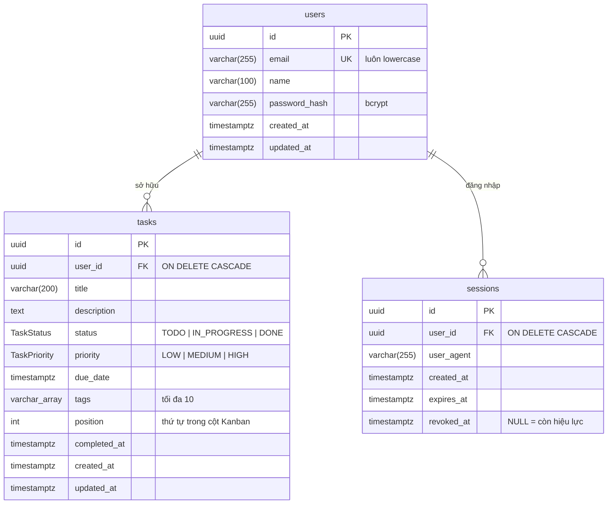

# Taskflow: Ứng dụng quản lý công việc cá nhân

Mini project cho vị trí **Backend / Fullstack Developer**. Ứng dụng cho phép người dùng đăng ký, đăng nhập, tạo, cập nhật và theo dõi tiến độ công việc, với giao diện **Kanban kéo thả**, danh sách có **tìm kiếm / lọc / phân trang** và **Dashboard** thống kê.

| | |
|---|---|
| **Backend** | Node.js 24 · Express 5 · TypeScript · Prisma ORM 6 · PostgreSQL · Zod · JWT · bcrypt |
| **Frontend** | React 19 · Vite · TypeScript · TanStack Query · React Router · dnd-kit |
| **Kiểm thử** | Vitest + Supertest (32 integration test chạy trên PostgreSQL thật) |
| **DevOps** | Docker Compose · GitHub Actions CI · Swagger/OpenAPI 3 |

Đề bài gốc: [`docs/DE_BAI.md`](docs/DE_BAI.md) · Giao diện tham khảo: [`images/demo.jpeg`](images/demo.jpeg)

**Live demo:** https://taskflow-jbw7.onrender.com · Swagger: https://taskflow-jbw7.onrender.com/api/docs

Tài khoản demo (sau khi seed): **`demo@taskflow.dev` / `Demo@1234`** (thêm `alice@taskflow.dev` / `Alice@1234` để thử phân quyền dữ liệu).

---

## Mục lục
1. [Chức năng](#1-chức-năng)
2. [Chạy dự án](#2-chạy-dự-án)
3. [Biến môi trường](#3-biến-môi-trường)
4. [Thiết kế database](#4-thiết-kế-database)
5. [API](#5-api)
6. [Kiểm thử & CI](#6-kiểm-thử--ci)
7. [Cấu trúc thư mục](#7-cấu-trúc-thư-mục)
8. [Quyết định kỹ thuật & bảo mật](#8-quyết-định-kỹ-thuật--bảo-mật)

---

## 1. Chức năng

### ✅ Đã hoàn thành: chức năng bắt buộc (MVP)

| Nhóm | Chi tiết |
|---|---|
| **Tài khoản** | Đăng ký, đăng nhập, đăng xuất. Mật khẩu hash bằng **bcrypt** (cost 12). Đăng xuất **thu hồi phiên phía server** (bảng `sessions`), token cũ không dùng lại được. |
| **Phân quyền dữ liệu** | Mọi truy vấn đều lọc theo `user_id` của người đang đăng nhập. Truy cập task của người khác trả `404` (không lộ việc task tồn tại). |
| **Task CRUD** | Tạo / xem / sửa (PATCH từng phần) / xoá. Mỗi task có tiêu đề, mô tả, trạng thái (`TODO`, `IN_PROGRESS`, `DONE`), mức ưu tiên (`LOW`, `MEDIUM`, `HIGH`), hạn hoàn thành, tags. |
| **Tìm kiếm & lọc** | Tìm theo tiêu đề (không phân biệt hoa thường, hỗ trợ tiếng Việt có dấu); lọc theo trạng thái và ưu tiên (chọn được nhiều giá trị); sắp xếp theo ngày tạo / hạn / ưu tiên / tên; **phân trang** phía server. |
| **Dashboard** | Tổng số task, số task chưa bắt đầu / đang làm / đã xong, tỉ lệ hoàn thành, số task quá hạn, **danh sách sắp đến hạn** (chọn 3/7/14/30 ngày), danh sách quá hạn, phân bố task còn mở theo ưu tiên. |

### ✅ Đã hoàn thành: chức năng cộng điểm

| Chức năng | Ghi chú |
|---|---|
| **Kanban kéo thả** | Kéo thẻ giữa các cột và sắp xếp lại trong cột (dnd-kit, hỗ trợ cả bàn phím). Thứ tự được lưu vào DB (`position`), cập nhật optimistic và hoàn tác nếu API lỗi. Kéo thả đúng cả khi board đang lọc. |
| **Docker Compose** | `docker compose up --build` chạy PostgreSQL + API + frontend (nginx), tự migrate và seed. |
| **Integration test** | 32 test: auth, phân quyền, CRUD, validate, tìm kiếm/lọc/phân trang, Kanban, dashboard, ràng buộc DB. |
| **Swagger / OpenAPI** | `http://localhost:4000/api/docs` |
| **CI pipeline** | GitHub Actions: typecheck + test (với Postgres service) + build cho cả backend và frontend mỗi lần push/PR. |
| **Deploy demo** | Render (gói miễn phí): https://taskflow-jbw7.onrender.com, cấu hình bằng [`render.yaml`](render.yaml). |
| **Giao diện responsive** | Desktop, tablet, mobile (sidebar dạng menu trượt, Kanban cuộn ngang). |

### ⏳ Chưa hoàn thành / hướng phát triển
- Quản lý **nhóm nhỏ** (chia sẻ project, giao task cho thành viên): schema hiện tại thiết kế cho cá nhân; có thể mở rộng bằng bảng `projects` + `project_members`.
- Refresh token + lưu token trong cookie `httpOnly` (hiện dùng access token + session thu hồi được, token lưu ở `localStorage`).
- Unit test cho frontend (hiện mới có integration test phía backend).
- Thông báo nhắc hạn qua email.

---

## 2. Chạy dự án

Có 3 cách, chọn cách phù hợp với máy của bạn.

### Cách 1: Docker Compose (nhanh nhất)

Yêu cầu: Docker Desktop.

```bash
docker compose up --build
```

| | URL |
|---|---|
| Ứng dụng | http://localhost:8080 |
| API | http://localhost:4000/api |
| Swagger | http://localhost:4000/api/docs |

Lần đầu khởi động, backend tự chạy migration và seed dữ liệu mẫu (`SEED_ON_START=true`).

### Cách 2: Chạy local với PostgreSQL có sẵn

Yêu cầu: Node.js ≥ 20 (khuyến nghị 24), PostgreSQL ≥ 14.

```bash
# 1. Backend
cd backend
cp .env.example .env          # sửa DATABASE_URL, JWT_SECRET nếu cần
npm install
npm run db:migrate            # tạo bảng
npm run db:seed               # dữ liệu mẫu
npm run dev                   # http://localhost:4000

# 2. Frontend (terminal khác)
cd frontend
npm install
npm run dev                   # http://localhost:5173  (tự proxy /api sang :4000)
```

> Với npm ≥ 11, các install script cần thiết (Prisma engines, esbuild…) đã được khai báo trong `allowScripts` của `backend/package.json`.

### Cách 3: Không có Docker lẫn PostgreSQL

Backend đi kèm script chạy **PostgreSQL nhúng** (package `embedded-postgres`, tải binary Postgres qua npm):

```bash
cd backend
cp .env.example .env
npm install
npm run db:local              # giữ terminal này mở, Postgres chạy ở cổng trong DATABASE_URL
```

Sau đó ở terminal khác làm tiếp từ bước `npm run db:migrate` của Cách 2.

### Deploy lên Render (link demo công khai)

Repo có sẵn [`render.yaml`](render.yaml) (Render Blueprint): 1 database PostgreSQL + 1 web service. Backend phục vụ luôn bản build của frontend nên cả giao diện, API và Swagger dùng chung một domain.

1. Đăng nhập https://dashboard.render.com bằng GitHub.
2. **New → Blueprint**, chọn repo này và nhánh chứa code, bấm **Apply**.
3. Đợi build xong (~5–10 phút), mở link `https://<tên-service>.onrender.com`.

Lưu ý gói miễn phí: service "ngủ" sau ~15 phút không có truy cập (lần mở đầu tiên mất ~1 phút để khởi động); database miễn phí có thời hạn sử dụng theo chính sách của Render. Dữ liệu demo được seed lại mỗi lần service khởi động.

> **Windows:** nếu đường dẫn thư mục dự án quá dài (> ~200 ký tự), Windows không nạp được DLL của Postgres (giới hạn MAX_PATH 260 ký tự). Hãy đặt dự án ở đường dẫn ngắn, ví dụ `C:\dev\taskflow`.

---

## 3. Biến môi trường

File mẫu: [`backend/.env.example`](backend/.env.example) (không chứa secret thật).

| Biến | Mặc định | Mô tả |
|---|---|---|
| `PORT` | `4000` | Cổng API |
| `CORS_ORIGIN` | `http://localhost:5173` | Origin frontend được phép gọi API (phân tách bằng dấu phẩy) |
| `DATABASE_URL` | | Chuỗi kết nối PostgreSQL |
| `TEST_DATABASE_URL` | | Database riêng cho integration test (**bị xoá dữ liệu** mỗi lần chạy test) |
| `JWT_SECRET` | | Chuỗi ngẫu nhiên ≥ 32 ký tự. Tạo bằng `node -e "console.log(require('crypto').randomBytes(48).toString('hex'))"` |
| `SESSION_TTL_HOURS` | `24` | Thời gian sống của phiên đăng nhập |
| `BCRYPT_ROUNDS` | `12` | Cost factor của bcrypt |

Biến môi trường được validate bằng Zod khi khởi động; thiếu hoặc sai thì server dừng kèm thông báo rõ ràng.

---

## 4. Thiết kế database



**Migration:** [`backend/prisma/migrations/20261123000000_init/migration.sql`](backend/prisma/migrations/20261123000000_init/migration.sql)

Ràng buộc dữ liệu (được kiểm chứng bởi test, chặn dữ liệu sai **kể cả khi bỏ qua tầng API**):

| Ràng buộc | Ý nghĩa |
|---|---|
| `FOREIGN KEY ... ON DELETE CASCADE` | Xoá user thì xoá luôn task và session |
| `UNIQUE (email)` + `CHECK (email = lower(email))` | Email không trùng, không phân biệt hoa thường |
| `CHECK` định dạng email, tên không rỗng | |
| `CHECK (length(btrim(title)) > 0)`, `VARCHAR(200)` | Tiêu đề bắt buộc, tối đa 200 ký tự |
| `CHECK (length(description) <= 5000)` | |
| `CHECK (position >= 0)`, `CHECK (cardinality(tags) <= 10)` | |
| `CHECK` `completed_at` khớp `status` | `completed_at` có giá trị **khi và chỉ khi** task ở trạng thái `DONE` |
| `ENUM TaskStatus`, `ENUM TaskPriority` | Chỉ nhận giá trị hợp lệ |
| Index `(user_id, status, position)`, `(user_id, priority)`, `(user_id, due_date)` | Phục vụ board, lọc, dashboard |

**Seed:** [`backend/prisma/seed.ts`](backend/prisma/seed.ts) tạo 2 tài khoản, 24 + 2 task với đủ trạng thái, mức ưu tiên và hạn (có cả task quá hạn / sắp đến hạn, hạn tính tương đối theo ngày chạy seed). Chạy lại nhiều lần được.

---

## 5. API

Tài liệu đầy đủ và thử trực tiếp: **Swagger UI tại `/api/docs`** (file nguồn [`backend/src/docs/openapi.yaml`](backend/src/docs/openapi.yaml)).

Xác thực bằng header `Authorization: Bearer <token>` (lấy từ login/register).

| Method | Endpoint | Mô tả |
|---|---|---|
| `POST` | `/api/auth/register` | Đăng ký `{ name, email, password }` → `{ user, token, expiresAt }` |
| `POST` | `/api/auth/login` | Đăng nhập `{ email, password }` |
| `POST` | `/api/auth/logout` | Thu hồi phiên hiện tại → `204` |
| `GET` | `/api/auth/me` | Thông tin người dùng |
| `GET` | `/api/tasks` | Danh sách + `search`, `status`, `priority`, `page`, `limit`, `sortBy`, `order` |
| `POST` | `/api/tasks` | Tạo task |
| `GET` | `/api/tasks/board` | Task nhóm theo trạng thái (Kanban), hỗ trợ `search`, `priority` |
| `GET` | `/api/tasks/:id` | Chi tiết |
| `PATCH` | `/api/tasks/:id` | Cập nhật một phần |
| `PATCH` | `/api/tasks/:id/move` | Kéo thả: `{ status, position }` hoặc `{ status, afterId }` |
| `DELETE` | `/api/tasks/:id` | Xoá → `204` |
| `GET` | `/api/dashboard?days=7` | Thống kê + danh sách sắp đến hạn / quá hạn |
| `GET` | `/api/health` | Health check |

Ví dụ:

```bash
# Đăng nhập
curl -s -X POST http://localhost:4000/api/auth/login \
  -H "Content-Type: application/json" \
  -d '{"email":"demo@taskflow.dev","password":"Demo@1234"}'

# Task ưu tiên cao chưa xong, hạn gần nhất trước, trang 1
curl -s "http://localhost:4000/api/tasks?status=TODO,IN_PROGRESS&priority=HIGH&sortBy=dueDate&order=asc&page=1&limit=10" \
  -H "Authorization: Bearer <token>"
```

Lỗi trả về theo định dạng thống nhất:

```json
{
  "error": {
    "code": "VALIDATION_ERROR",
    "message": "Dữ liệu không hợp lệ",
    "details": [{ "field": "title", "message": "Tiêu đề không được để trống" }]
  }
}
```

| Status | Khi nào |
|---|---|
| `400` | Dữ liệu không hợp lệ (Zod), id không phải UUID, JSON sai cú pháp |
| `401` | Chưa đăng nhập, token sai/hết hạn, phiên đã đăng xuất, sai email/mật khẩu |
| `404` | Không tìm thấy hoặc task thuộc người khác |
| `409` | Email đã tồn tại |
| `429` | Gọi `/auth/login`, `/auth/register` quá 20 lần / 15 phút / IP |

---

## 6. Kiểm thử & CI

```bash
cd backend
npm test          # cần TEST_DATABASE_URL trỏ tới 1 database riêng
```

Test chạy trên **PostgreSQL thật** (tự migrate database test trước khi chạy, xoá dữ liệu trước mỗi test):

- **auth.test.ts:** đăng ký, hash bcrypt, email trùng (không phân biệt hoa thường), validate, đăng nhập, sai mật khẩu trả cùng thông báo với email không tồn tại, logout thu hồi token, logout một phiên không ảnh hưởng phiên khác.
- **tasks.test.ts:** CRUD, giá trị mặc định, validate, `completedAt`, **phân quyền dữ liệu giữa 2 user**, tìm kiếm tiếng Việt, lọc nhiều giá trị, phân trang không trùng/sót bản ghi, sắp xếp theo hạn (task không hạn nằm cuối), Kanban move theo `position` và `afterId`, **CHECK constraint & cascade ở tầng DB**.
- **dashboard.test.ts:** thống kê, quá hạn, sắp đến hạn, không tính dữ liệu của người khác.

```
 Test Files  3 passed (3)
      Tests  32 passed (32)
```

**CI:** [`.github/workflows/ci.yml`](.github/workflows/ci.yml) chạy typecheck, test và build cho backend (kèm Postgres service), cùng typecheck và build cho frontend ở mỗi lần push và pull request.

---

## 7. Cấu trúc thư mục

```
.
├── backend
│   ├── prisma
│   │   ├── schema.prisma            # data model
│   │   ├── migrations/              # SQL migration (FK, CHECK, index)
│   │   └── seed.ts                  # dữ liệu mẫu
│   ├── src
│   │   ├── config/env.ts            # validate biến môi trường
│   │   ├── middleware/              # auth (JWT + session), error handler
│   │   ├── modules
│   │   │   ├── auth/                # routes · service · zod schemas
│   │   │   ├── tasks/               # routes · service · zod schemas
│   │   │   └── dashboard/
│   │   ├── docs/openapi.yaml        # Swagger
│   │   ├── app.ts                   # Express app
│   │   └── server.ts
│   ├── tests/                       # integration tests (Vitest + Supertest)
│   ├── scripts/local-db.ts          # PostgreSQL nhúng cho máy không có Docker
│   └── Dockerfile
├── frontend
│   ├── src
│   │   ├── api/                     # fetch client, React Query hooks, types
│   │   ├── auth/                    # AuthContext
│   │   ├── components/              # KanbanBoard, TaskModal, TaskTable, Layout...
│   │   ├── pages/                   # Dashboard, Tasks, Auth
│   │   └── styles.css
│   ├── nginx.conf
│   └── Dockerfile
├── docker-compose.yml
└── .github/workflows/ci.yml
```

---

## 8. Quyết định kỹ thuật & bảo mật

- **Tách lớp route → service → Prisma.** Route chỉ parse input bằng Zod và gọi service; nghiệp vụ (vị trí Kanban, `completedAt`, phân quyền) nằm ở service.
- **Phân quyền ở mọi truy vấn:** dùng `findFirst({ where: { id, userId } })` / `deleteMany({ where: { id, userId } })` thay cho `findUnique({ id })`, nên không thể quên kiểm tra quyền sở hữu.
- **Không rò rỉ `password_hash`:** Prisma `omit` toàn cục, chỉ bật lại ở đúng truy vấn đăng nhập.
- **Chống dò tài khoản (user enumeration):** sai email và sai mật khẩu trả cùng thông báo; khi email không tồn tại vẫn so sánh bcrypt với một hash giả để thời gian phản hồi tương đương.
- **Logout thật sự:** JWT mang `sid`; mỗi request kiểm tra session còn hiệu lực, nên đăng xuất thì token bị vô hiệu ngay dù chưa hết hạn.
- **Rate limit** cho login/register, **helmet** cho security header, giới hạn body 100 KB, `PATCH` dùng `.strict()` để chặn ghi đè trường không cho phép (vd. `userId`).
- **Kanban:** API `move` đánh lại `position` liên tục 0..n trong transaction. Hỗ trợ `afterId` để kéo thả chính xác khi board đang lọc (chỉ số hiển thị khác chỉ số thật trong cột).
- **Tìm kiếm tiếng Việt:** `ILIKE` phụ thuộc collation của DB; Docker Compose và `db:local` khởi tạo Postgres với ICU locale để `"thiết kế"` khớp `"THIẾT KẾ"`.
- **Hạn hoàn thành** lưu `timestamptz`; frontend chọn theo ngày và lưu 23:59 giờ địa phương, nên task hạn "hôm nay" vẫn tính là sắp đến hạn cho tới hết ngày.

---

## Video demo

> _(Chèn link video demo 3–5 phút tại đây)_
