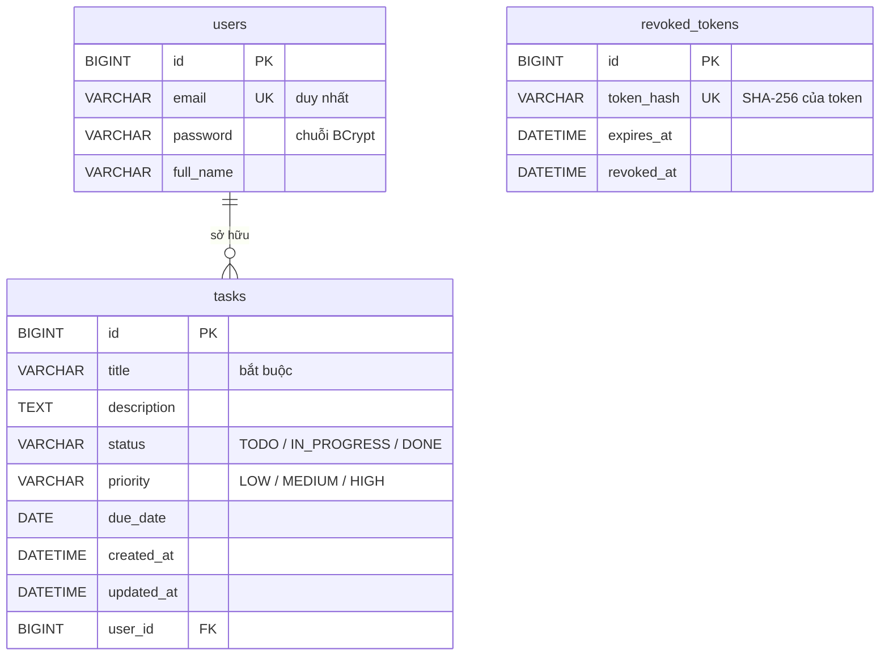

# Task Management System

[](https://github.com/TanSeng2027/Task-Management-System/actions/workflows/ci.yml)


Ứng dụng quản lý công việc cá nhân, làm theo đề bài tuyển dụng Intern (Mini Project Backend / Fullstack).
Người dùng đăng ký tài khoản rồi tạo, sửa, xóa, tìm kiếm và theo dõi tiến độ công việc của mình trên
bảng Kanban, danh sách và dashboard. Có thêm tính năng **tạo task bằng một câu nói tự nhiên** nhờ AI.

- **Backend:** REST API bằng Spring Boot, xác thực JWT, database migration bằng Flyway.
- **Frontend:** HTML + CSS + JavaScript thuần (không framework), được Spring Boot phục vụ luôn nên chỉ cần chạy 1 ứng dụng.
- **Demo online:** https://task-management-system-7qbe.onrender.com
- **Swagger UI:** https://task-management-system-7qbe.onrender.com/swagger-ui.html
- **Video demo:** https://youtu.be/lpKWd62n6PY 

> **Tài khoản demo** (có sẵn dữ liệu mẫu): `alice@example.com` / `Password@123` hoặc `bob@example.com` / `Password@123`

---

## Mục lục

1. [Công nghệ sử dụng](#1-công-nghệ-sử-dụng)
2. [Chức năng](#2-chức-năng)
3. [Cài đặt và chạy dự án](#3-cài-đặt-và-chạy-dự-án)
4. [Hướng dẫn sử dụng](#4-hướng-dẫn-sử-dụng)
5. [Tài liệu API](#5-tài-liệu-api)
6. [Database](#6-database)
7. [Cấu trúc thư mục](#7-cấu-trúc-thư-mục)
8. [Test và CI](#8-test-và-ci)
9. [Deploy](#9-deploy)
10. [Đóng góp](#10-đóng-góp)
11. [Tác giả và ghi nhận](#11-tác-giả-và-ghi-nhận)
12. [License](#12-license)

---

## 1. Công nghệ sử dụng

| Thành phần | Công nghệ |
|---|---|
| Ngôn ngữ | Java 21 |
| Framework | Spring Boot 4.2 (Web MVC, Data JPA, Validation, Security) |
| Xác thực | JWT (jjwt 0.11.5), mật khẩu mã hóa BCrypt |
| Database | MySQL 8.4 (Docker), H2 chế độ MySQL (chạy local và test), tương thích TiDB Cloud |
| Migration | Flyway |
| Tài liệu API | springdoc-openapi 3 (Swagger UI) |
| Frontend | HTML, CSS, JavaScript thuần |
| AI | Google Gemini (`gemini-3.5-flash-lite`), structured output dạng JSON |
| Test | JUnit 5, Mockito, Spring Boot Test, MockMvc |
| Đóng gói, CI | Docker, Docker Compose, GitHub Actions |

---

## 2. Chức năng

### Chức năng bắt buộc (MVP)

| Yêu cầu của đề bài | Trạng thái | Ghi chú |
|---|---|---|
| Đăng ký, đăng nhập, đăng xuất | ✅ | Đăng xuất thu hồi token thật: token bị đưa vào danh sách đen, gọi lại API sẽ nhận 401 |
| Mật khẩu mã hóa an toàn | ✅ | BCrypt, không bao giờ trả mật khẩu về client |
| Người dùng chỉ truy cập dữ liệu của mình | ✅ | Mọi truy vấn đều lọc theo user đăng nhập. Truy cập task của người khác trả 404 (không tiết lộ task có tồn tại) |
| Tạo, xem, sửa, xóa task | ✅ | |
| Task có tiêu đề, mô tả, trạng thái, mức ưu tiên, hạn hoàn thành | ✅ | Trạng thái `TODO`, `IN_PROGRESS`, `DONE`; ưu tiên `LOW`, `MEDIUM`, `HIGH` |
| Tìm kiếm theo tiêu đề | ✅ | Không phân biệt hoa thường |
| Lọc theo trạng thái và mức ưu tiên | ✅ | Kết hợp được với tìm kiếm và sắp xếp |
| Phân trang | ✅ | `page`, `size` (tối đa 100), `sort` |
| Dashboard: tổng số task, số task theo trạng thái | ✅ | Có thêm số task quá hạn |
| Dashboard: danh sách task sắp đến hạn | ✅ | Task chưa xong có hạn trong N ngày tới (mặc định 7, chọn được 1–30) |

### Chức năng cộng điểm

| Yêu cầu | Trạng thái | Ghi chú |
|---|---|---|
| Giao diện Kanban, kéo thả task giữa các trạng thái | ✅ | Có thêm chế độ xem dạng danh sách |
| Docker Compose | ✅ | MySQL + app, 1 lệnh là chạy |
| Unit test, integration test | ✅ | 98 test |
| Swagger / OpenAPI | ✅ | Có mô tả, ví dụ và mã lỗi cho từng API |
| CI pipeline chạy test khi push | ✅ | GitHub Actions: chạy test, rồi dựng Docker Compose và gọi thử API |
| Deploy demo lên cloud | ✅ | Render (app) + TiDB Cloud Starter (database). Xem [Deploy](#9-deploy) |

### Chức năng làm thêm

- **Thêm task bằng câu nói tự nhiên (AI):** gõ _"Tôi đang làm deadline môn Python tới ngày 12 tháng 12, gấp lắm"_,
  AI điền sẵn tiêu đề, hạn, mức ưu tiên và trạng thái vào form. Người dùng xem lại rồi mới lưu.
  Giới hạn số lần gọi theo từng user mỗi giờ và cho cả app mỗi ngày để không vượt hạn mức miễn phí.
  Không có API key thì tính năng tự ẩn, các chức năng khác vẫn chạy bình thường.
- Ô nhập ngày theo định dạng Việt Nam `dd/mm/yyyy`, có nút mở lịch.
- Format lỗi JSON thống nhất cho mọi API, kèm lỗi chi tiết theo từng field khi dữ liệu không hợp lệ.
- Job chạy mỗi giờ để dọn các token đã đăng xuất và đã hết hạn.
- Bảo mật phía trình duyệt:
  - Header **Content-Security-Policy**: chỉ cho chạy script và gọi API của chính web, nên kể cả có lỗi XSS thì mã lạ cũng không chạy được.
  - Chống **clickjacking**: trang web khác không nhúng được app vào iframe.
  - Token lưu trong `sessionStorage`: đóng tab hoặc tắt trình duyệt là tự đăng xuất, an toàn trên máy dùng chung.
  - Frontend chỉ gửi token tới chính server của app, không gửi sang tên miền khác.

### Chưa hoàn thành / hướng phát triển

- **Làm việc nhóm:** chưa có chia sẻ task hay giao task cho người khác. Hiện mỗi người chỉ quản lý task của mình.
- **AI chia nhỏ task thành các bước con:** đã cân nhắc nhưng không làm, để giữ phạm vi dự án gọn.
- Refresh token, quên mật khẩu qua email, xác thực email khi đăng ký.
- Thông báo (email hoặc trên web) khi task sắp đến hạn.
- Đa ngôn ngữ (hiện giao diện và thông báo lỗi bằng tiếng Việt).

---

## 3. Cài đặt và chạy dự án

Có 2 cách chạy. **Cách 1** nhanh nhất, chỉ cần Java. **Cách 2** chạy giống môi trường thật với MySQL.

### Yêu cầu

| Cách chạy | Cần cài |
|---|---|
| Cách 1: Maven + H2 | **JDK 21**. Không cần cài Maven (dự án có sẵn Maven Wrapper `mvnw`) |
| Cách 2: Docker Compose | **Docker Desktop** (hoặc Docker Engine + Compose v2) |

### Bước chung: tạo file `.env`

Mọi lệnh dưới đây chạy trong thư mục `task-management`.

```bash
git clone https://github.com/TanSeng2027/Task-Management-System.git
cd Task-Management-System/task-management
cp .env.example .env          # Windows cmd: copy .env.example .env
```

Mở file `.env` và điền **`JWT_SECRET`** (bắt buộc). Đây phải là chuỗi Base64 dài tối thiểu 32 byte.
Tạo ngẫu nhiên bằng 1 trong 2 lệnh:

```bash
openssl rand -base64 64
python -c "import secrets,base64;print(base64.b64encode(secrets.token_bytes(64)).decode())"
```

Copy kết quả thành **1 dòng** (không xuống dòng) vào `JWT_SECRET=...`. Giá trị mẫu trong `.env.example`
cố ý không hợp lệ, nên chưa sửa thì app sẽ báo lỗi rõ ràng khi khởi động.

> File `.env` chứa secret thật nên đã nằm trong `.gitignore`. Chỉ commit `.env.example`.

### Cách 1: Chạy bằng Maven với H2 (nhanh nhất)

Database H2 chạy trong bộ nhớ, không cần cài MySQL. **Dữ liệu sẽ mất khi tắt app**
(mỗi lần chạy lại sẽ có lại dữ liệu mẫu).

| Terminal | Lệnh |
|---|---|
| Windows **cmd** | `mvnw spring-boot:run` |
| Windows **PowerShell** | `.\mvnw spring-boot:run` |
| Git Bash, macOS, Linux | `./mvnw spring-boot:run` |

Lần đầu Maven sẽ tải thư viện nên mất vài phút. Khi thấy dòng `Started TaskManagementApplication` là chạy xong.

| Địa chỉ | Nội dung |
|---|---|
| http://localhost:8080 | Giao diện web |
| http://localhost:8080/swagger-ui.html | Swagger UI (tài liệu và gọi thử API) |
| http://localhost:8080/h2-console | Xem database H2. JDBC URL: `jdbc:h2:mem:taskdb`, user `sa`, mật khẩu để trống |

Dừng app: bấm `Ctrl + C`.

### Cách 2: Chạy bằng Docker Compose (MySQL + app)

Trong `.env`, ngoài `JWT_SECRET` hãy đặt thêm `MYSQL_PASSWORD` và `MYSQL_ROOT_PASSWORD`. Sau đó:

```bash
docker compose up -d --build
```

Lần đầu mất vài phút để build image. App chỉ khởi động sau khi MySQL sẵn sàng, và Flyway tự tạo bảng cùng dữ liệu mẫu.
Mở http://localhost:8080 như cách 1. Dữ liệu được giữ lại khi tắt và bật lại container.

| Việc cần làm | Lệnh |
|---|---|
| Xem log của app | `docker compose logs -f app` |
| Dừng | `docker compose down` |
| Dừng và **xóa toàn bộ dữ liệu** | `docker compose down -v` |
| Chạy lại sau khi sửa code | `docker compose up -d --build` |

Kết nối MySQL bằng MySQL Workbench: host `localhost`, port `3306`, user và mật khẩu là `MYSQL_USER` / `MYSQL_PASSWORD` trong `.env`.

### Biến môi trường

Chi tiết và ví dụ có trong [.env.example](.env.example).

| Biến | Bắt buộc | Mặc định | Ý nghĩa |
|---|---|---|---|
| `JWT_SECRET` | ✅ | | Khóa ký JWT, chuỗi Base64 tối thiểu 32 byte |
| `JWT_EXPIRATION` | | `86400000` | Thời gian sống của token (ms), mặc định 24 giờ |
| `PORT` / `SERVER_PORT` | | `8080` | Cổng chạy app. `PORT` do nền tảng cloud cấp, được ưu tiên hơn |
| `DB_URL`, `DB_USERNAME`, `DB_PASSWORD` | | H2 in-memory | Kết nối database. Đổi sang MySQL hoặc TiDB chỉ cần đổi 3 biến này |
| `MYSQL_DATABASE`, `MYSQL_USER`, `MYSQL_PASSWORD`, `MYSQL_ROOT_PASSWORD`, `MYSQL_PORT` | Khi dùng Docker Compose | | Cấu hình container MySQL |
| `H2_CONSOLE_ENABLED` | | `true` | Bật trang `/h2-console`. Nên tắt khi deploy |
| `AI_API_KEY` | | trống | Key Google Gemini. Để trống thì tắt tính năng AI |
| `AI_MODEL` | | `gemini-3.5-flash-lite` | Model Gemini |
| `AI_MAX_REQUESTS_PER_HOUR` | | `20` | Số lần gọi AI tối đa của 1 user trong 1 giờ |
| `AI_MAX_REQUESTS_PER_DAY` | | `200` | Tổng số lần gọi AI của cả app trong 24 giờ (`0` = không giới hạn) |
| `TZ` | | `Asia/Ho_Chi_Minh` | Múi giờ, ảnh hưởng tới cách tính "hôm nay", "quá hạn" |

### Bật tính năng AI (không bắt buộc)

1. Vào https://aistudio.google.com, đăng nhập Google, chọn **Get API key**. Key miễn phí.
2. Dán key vào `AI_API_KEY=` trong `.env` rồi chạy lại app.

> **Lưu ý về dữ liệu:** ở gói miễn phí, Google có thể dùng nội dung gửi lên để cải thiện sản phẩm.
> App chỉ gửi câu mô tả mà người dùng gõ vào ô AI (không gửi task hay thông tin tài khoản),
> nhưng không nên nhập thông tin nhạy cảm vào ô này.

### Lỗi thường gặp

| Lỗi | Cách xử lý |
|---|---|
| `'.' is not recognized as an internal or external command` | Đang dùng cmd. Gõ `mvnw spring-boot:run` (bỏ `./`) |
| `JWT_SECRET phải là chuỗi Base64 hợp lệ` hoặc `JWT_SECRET quá ngắn` | Chưa tạo `.env` hoặc chưa thay giá trị mẫu. Xem [Bước chung](#bước-chung-tạo-file-env) |
| `Port 8080 was already in use` | Có app khác đang chạy cổng 8080, thường là container Docker Compose. Chạy `docker compose down`, hoặc đặt `SERVER_PORT=8081` trong `.env` |
| `Thiếu MYSQL_PASSWORD trong file .env` | Điền `MYSQL_PASSWORD` và `MYSQL_ROOT_PASSWORD` trong `.env` trước khi chạy Docker Compose |

---

## 4. Hướng dẫn sử dụng

### Giao diện web

1. Mở http://localhost:8080 và đăng nhập bằng tài khoản demo `alice@example.com` / `Password@123`, hoặc chọn **Đăng ký** để tạo tài khoản mới.
   Phiên đăng nhập gắn với tab đang mở: tải lại trang vẫn giữ đăng nhập, còn mở tab mới hoặc mở lại trình duyệt thì cần đăng nhập lại.
2. **Dashboard:** xem tổng số task, số task theo trạng thái, số task quá hạn và các task sắp đến hạn.
3. **Công việc:**
   - **Bảng Kanban:** kéo thả task giữa 3 cột _Cần làm_, _Đang làm_, _Hoàn thành_ để đổi trạng thái.
   - **Danh sách:** xem dạng bảng có phân trang.
   - Ô tìm kiếm, bộ lọc trạng thái, mức ưu tiên và sắp xếp dùng được ở cả 2 chế độ.
4. **Thêm task:** bấm **+ Thêm task**, nhập thông tin. Hạn hoàn thành nhập dạng `dd/mm/yyyy` hoặc chọn trên lịch.
5. **Thêm bằng AI** (khi đã bật): trong hộp thoại thêm task, gõ một câu như
   _"Nộp báo cáo thực tập trước thứ 6 tuần sau, quan trọng"_ rồi bấm **Điền tự động**.
   Form được điền sẵn, kiểm tra lại rồi bấm **Lưu**.
6. Bấm vào một task để sửa hoặc xóa.

### Gọi API bằng Swagger UI

1. Mở http://localhost:8080/swagger-ui.html.
2. Gọi `POST /api/auth/login` với tài khoản demo, copy giá trị `accessToken` trong kết quả.
3. Bấm nút **Authorize** ở góc trên, dán token vào và bấm **Authorize**.
4. Bây giờ có thể gọi thử mọi API khác. Token được giữ lại khi tải lại trang.

### Gọi API bằng curl

```bash
# Đăng nhập, lấy token
curl -X POST http://localhost:8080/api/auth/login \
  -H "Content-Type: application/json" \
  -d '{"email":"alice@example.com","password":"Password@123"}'

# Dùng token để gọi API (thay <TOKEN> bằng accessToken ở trên)
curl "http://localhost:8080/api/tasks?search=api&status=IN_PROGRESS&page=0&size=10&sort=dueDate,asc" \
  -H "Authorization: Bearer <TOKEN>"
```

> Trên Windows PowerShell hãy gõ `curl.exe` thay cho `curl`.

---

## 5. Tài liệu API

Tài liệu đầy đủ (body mẫu, mã lỗi, thử trực tiếp) xem ở **Swagger UI**: `/swagger-ui.html`.
File OpenAPI dạng JSON: `/v3/api-docs`.

Các API có 🔒 cần header `Authorization: Bearer <accessToken>`.

| Method | Endpoint | Mô tả |
|---|---|---|
| `POST` | `/api/auth/register` | Đăng ký. Body: `fullName`, `email`, `password` (tối thiểu 6 ký tự) |
| `POST` | `/api/auth/login` | Đăng nhập. Trả về `accessToken`, `tokenType`, `expiresIn`, `email`, `fullName` |
| `POST` | `/api/auth/logout` 🔒 | Đăng xuất, thu hồi token hiện tại |
| `GET` | `/api/tasks` 🔒 | Danh sách task, có tìm kiếm, lọc, phân trang (xem bảng dưới) |
| `GET` | `/api/tasks/{id}` 🔒 | Chi tiết 1 task |
| `POST` | `/api/tasks` 🔒 | Tạo task |
| `PUT` | `/api/tasks/{id}` 🔒 | Cập nhật task |
| `DELETE` | `/api/tasks/{id}` 🔒 | Xóa task |
| `GET` | `/api/dashboard?days=7` 🔒 | Thống kê và task sắp đến hạn trong `days` ngày tới (1–30) |
| `GET` | `/api/ai/status` 🔒 | Tính năng AI có đang bật không |
| `POST` | `/api/ai/parse-task` 🔒 | Phân tích câu tự nhiên thành gợi ý task (không lưu vào database) |

### Tham số của `GET /api/tasks`

Tất cả đều không bắt buộc và kết hợp được với nhau.

| Tham số | Ví dụ | Ý nghĩa |
|---|---|---|
| `search` | `api` | Tìm theo tiêu đề, không phân biệt hoa thường |
| `status` | `TODO` | `TODO`, `IN_PROGRESS`, `DONE` |
| `priority` | `HIGH` | `LOW`, `MEDIUM`, `HIGH` |
| `page` | `0` | Trang, bắt đầu từ 0 |
| `size` | `10` | Số task mỗi trang, mặc định 10, tối đa 100 |
| `sort` | `dueDate,asc` | Mặc định `createdAt,desc`. Field hợp lệ: `title`, `status`, `priority`, `dueDate`, `createdAt`, `updatedAt` |

### Body tạo và cập nhật task

```json
{
  "title": "Viết API tìm kiếm task",
  "description": "Tìm theo tiêu đề, lọc theo trạng thái và mức ưu tiên",
  "status": "TODO",
  "priority": "HIGH",
  "dueDate": "2026-12-31"
}
```

- Chỉ `title` là bắt buộc (tối đa 255 ký tự). `description` tối đa 5000 ký tự. `dueDate` dạng `yyyy-MM-dd`.
- Khi **tạo**, không gửi `status` / `priority` thì mặc định là `TODO` / `MEDIUM`.
- Khi **cập nhật**, không gửi `status` / `priority` thì giữ nguyên giá trị cũ. `description`, `dueDate` không gửi sẽ bị xóa.

### Format lỗi

Các lỗi `400`, `404`, `409`, `429`, `502`, `503` trả về cùng một dạng JSON (`401` chỉ trả mã lỗi, không có body):

```json
{
  "timestamp": "2026-11-24T10:15:30",
  "status": 400,
  "error": "Bad Request",
  "message": "Dữ liệu không hợp lệ",
  "errors": { "title": "Tiêu đề không được để trống" }
}
```

| Mã | Khi nào |
|---|---|
| `400` | Dữ liệu không hợp lệ, sai giá trị `status` / `priority` / `sort` |
| `401` | Sai email hoặc mật khẩu khi đăng nhập; chưa đăng nhập; token sai, hết hạn hoặc đã đăng xuất |
| `404` | Không tìm thấy task, hoặc task thuộc về người khác |
| `409` | Email đã được đăng ký |
| `429` | Gọi AI quá số lần cho phép |
| `502` | AI trả về kết quả không đọc được |
| `503` | Tính năng AI đang tắt hoặc dịch vụ AI tạm thời không phản hồi |

---

## 6. Database

### Sơ đồ



### Migration (Flyway)

Các file ở [src/main/resources/db/migration](src/main/resources/db/migration). Flyway tự chạy khi app khởi động.
Hibernate chỉ kiểm tra schema (`ddl-auto: validate`), không tự sửa bảng.

| File | Nội dung |
|---|---|
| `V1__create_users_table.sql` | Bảng `users`, email là `UNIQUE` |
| `V2__create_tasks_table.sql` | Bảng `tasks`: khóa ngoại tới `users` (`ON DELETE CASCADE`), `CHECK` cho `status` và `priority`, index theo `user_id` kết hợp trạng thái / ưu tiên / hạn |
| `V3__seed_data.sql` | Dữ liệu mẫu: 2 tài khoản demo, 10 task của Alice (đủ trạng thái, ưu tiên, có task quá hạn và sắp đến hạn), 3 task của Bob |
| `V4__create_revoked_tokens_table.sql` | Bảng lưu token đã đăng xuất. Chỉ lưu SHA-256 của token, không lưu token gốc |

Hạn của dữ liệu mẫu tính theo ngày chạy migration, nên dashboard luôn có task "sắp đến hạn" để xem.
Các file migration viết bằng cú pháp chạy được trên cả MySQL và H2.

---

## 7. Cấu trúc thư mục

```text
Task-Management-System/
├── .github/workflows/ci.yml        # GitHub Actions: test + Docker smoke test
└── task-management/
    ├── src/main/java/com/tanseng2027/task_management/
    │   ├── TaskManagementApplication.java
    │   ├── ai/              # Gọi Gemini API, giới hạn số lần gọi
    │   ├── config/          # Spring Security, Swagger, cấu hình bean
    │   ├── controller/      # REST API: auth, tasks, dashboard, ai
    │   ├── dto/             # Dữ liệu vào (request) và ra (response) của API
    │   ├── entity/          # User, Task, RevokedToken, enum TaskStatus, TaskPriority
    │   ├── exception/       # Xử lý lỗi tập trung, format lỗi JSON
    │   ├── repository/      # Spring Data JPA, Specification cho tìm kiếm và lọc
    │   ├── security/        # Tạo/kiểm tra JWT, filter xác thực, danh sách token đã thu hồi
    │   └── service/         # Logic nghiệp vụ, kiểm tra quyền sở hữu task
    ├── src/main/resources/
    │   ├── application.yml
    │   ├── db/migration/    # Flyway V1–V4
    │   └── static/          # Frontend: index.html, css/, js/
    ├── src/test/            # Unit test và integration test
    ├── .env.example         # Biến môi trường mẫu (không chứa secret thật)
    ├── Dockerfile           # Build 2 giai đoạn, chạy bằng user thường
    ├── docker-compose.yml   # MySQL + app
    └── pom.xml
```

Luồng xử lý một request: `JwtAuthenticationFilter` kiểm tra token → `Controller` nhận và validate dữ liệu →
`Service` xử lý nghiệp vụ, luôn lọc theo user đăng nhập → `Repository` truy vấn database → trả về DTO.

---

## 8. Test và CI

### Chạy test

```bash
./mvnw test          # cmd: mvnw test   ·   PowerShell: .\mvnw test
```

Test dùng H2 và profile `test` riêng, **không cần** file `.env` hay database ngoài. Kết quả: **98 test, tất cả pass**.

| Nhóm | Nội dung kiểm tra |
|---|---|
| Unit test service | Tạo, sửa, xóa task, kiểm tra quyền sở hữu, tính dashboard, xử lý kết quả AI |
| Unit test security | Tạo và kiểm tra JWT, token hết hạn, sai chữ ký, danh sách token đã thu hồi |
| Unit test AI | Giới hạn theo user và theo cả app, gọi lại khi Gemini quá tải, xử lý lỗi (giả lập server Gemini, không gọi thật) |
| Integration test API | Gọi API thật qua MockMvc với database H2: đăng ký, đăng nhập, đăng xuất, CRUD, tìm kiếm, lọc, phân trang, dashboard, mã lỗi, header bảo mật (CSP, chống clickjacking), **user A không xem/sửa/xóa được task của user B** |

### CI (GitHub Actions)

File [.github/workflows/ci.yml](../.github/workflows/ci.yml) chạy mỗi khi push hoặc tạo Pull Request:

1. **Build & Test:** chạy toàn bộ test với JDK 21 và build file `.jar`. Báo cáo test được lưu lại để tải về.
2. **Docker Compose smoke test:** dựng MySQL và app bằng Docker Compose với secret sinh ngẫu nhiên,
   rồi gọi API thật: đăng nhập bằng tài khoản demo, kiểm tra danh sách task, dashboard và kiểm tra API trả 401 khi không có token.

Xem kết quả ở tab **Actions** trên GitHub.

---

## 9. Deploy

Bản demo chạy tại **https://task-management-system-7qbe.onrender.com**, dùng toàn bộ dịch vụ miễn phí:

| Thành phần | Nền tảng | Ghi chú |
|---|---|---|
| App | [Render](https://render.com) Web Service, gói Free | Build từ `Dockerfile`, Root Directory là `task-management` |
| Database | [TiDB Cloud Starter](https://tidbcloud.com) | Miễn phí, tương thích MySQL, cổng 4000, bắt buộc SSL |

Biến môi trường cần khai báo trên Render: `JWT_SECRET` (tạo mới, không dùng lại của máy local), `DB_URL`,
`DB_USERNAME`, `DB_PASSWORD`, `AI_API_KEY`, `AI_MAX_REQUESTS_PER_HOUR`, `AI_MAX_REQUESTS_PER_DAY`,
`H2_CONSOLE_ENABLED=false`, `TZ=Asia/Ho_Chi_Minh`. Render tự cấp `PORT`.

`DB_URL` cho TiDB có dạng:

```text
jdbc:mysql://<host>:4000/taskdb?sslMode=VERIFY_IDENTITY&createDatabaseIfNotExist=true&characterEncoding=UTF-8
```

Những điểm đã chuẩn bị cho deploy:

- App đọc cổng từ biến `PORT` mà nền tảng cấp.
- Đọc header `X-Forwarded-*` nên khi chạy sau proxy HTTPS, Swagger vẫn gọi API bằng `https://`.
- Tham số JVM trong `Dockerfile` cho container RAM nhỏ. Đo thực tế: app dùng khoảng **320MB / 512MB**
  sau khoảng 650 request.
- Đã chạy thử đầy đủ migration và API trên TiDB. TiDB bỏ qua ràng buộc `CHECK`, nhưng app vẫn validate dữ liệu ở tầng API nên không ảnh hưởng.

> **Lưu ý gói Free của Render:** app tự ngủ sau khoảng 15 phút không có ai truy cập.
> Lần truy cập đầu tiên sau đó cần **1–2 phút** để khởi động lại, những lần sau sẽ nhanh bình thường.

---

## 10. Đóng góp

1. Fork repo và tạo nhánh mới từ nhánh chính: `git checkout -b feature/ten-tinh-nang`.
2. Code và viết test cho phần thay đổi. Chạy `./mvnw test` để chắc chắn tất cả test pass.
3. Commit với nội dung rõ ràng, push lên fork của bạn.
4. Tạo Pull Request, mô tả thay đổi và cách kiểm tra. CI sẽ tự chạy test.

Quy ước:

- Không commit file `.env` hay bất kỳ secret nào. Thêm biến mới thì cập nhật `.env.example`.
- Thay đổi database luôn bằng file migration mới (`V5__...sql`), không sửa file migration đã chạy.
- Thêm hoặc sửa API thì cập nhật mô tả Swagger (`@Operation`, `@ApiResponse`) và bảng API trong README.

---

## 11. Tác giả và ghi nhận

- **Tác giả:** Lu Chien Tan Sang ([@TanSeng2027](https://github.com/TanSeng2027))
- **Đề bài:** [TechVanguardVn/Task-Management-System](https://github.com/TechVanguardVn/Task-Management-System)
- Thư viện và dịch vụ sử dụng: [Spring Boot](https://spring.io/projects/spring-boot),
  [jjwt](https://github.com/jwtk/jjwt), [Flyway](https://github.com/flyway/flyway),
  [springdoc-openapi](https://springdoc.org), [Google Gemini API](https://ai.google.dev).

---

## 12. License

Dự án được làm cho bài kiểm tra tuyển dụng, hiện **chưa gắn license**. Theo mặc định, mọi quyền thuộc về tác giả.
